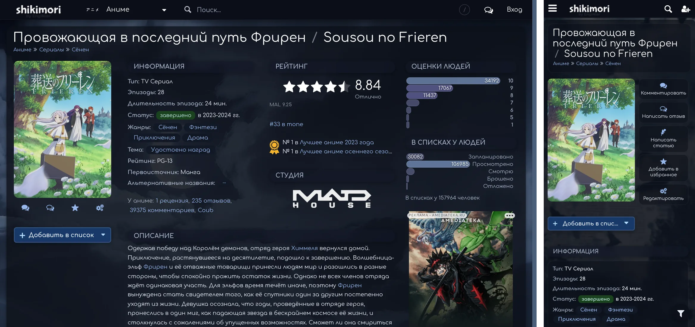
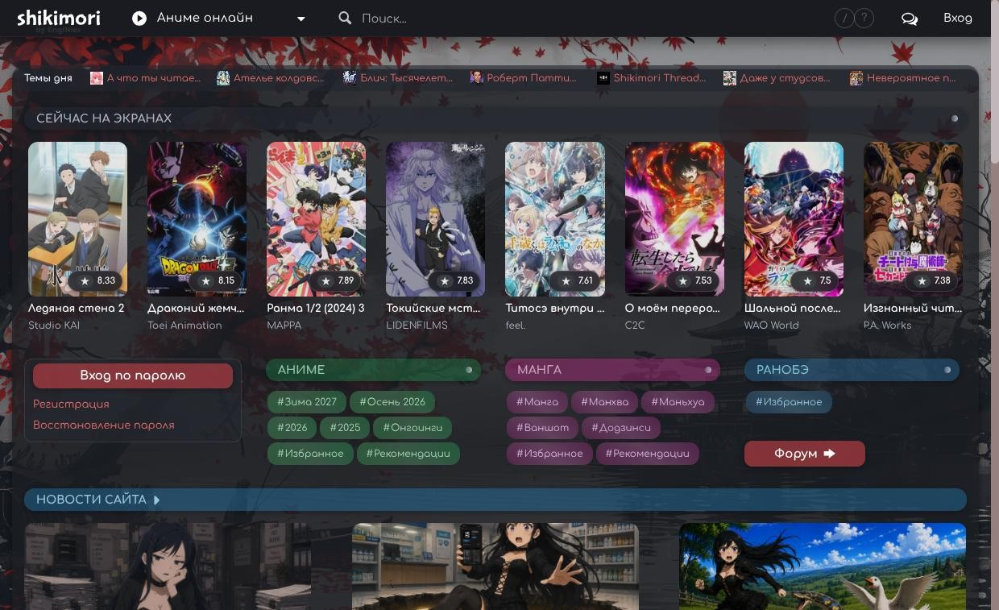
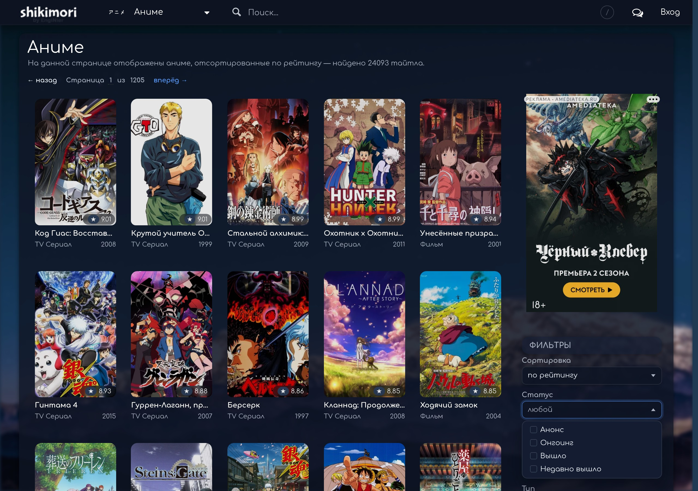
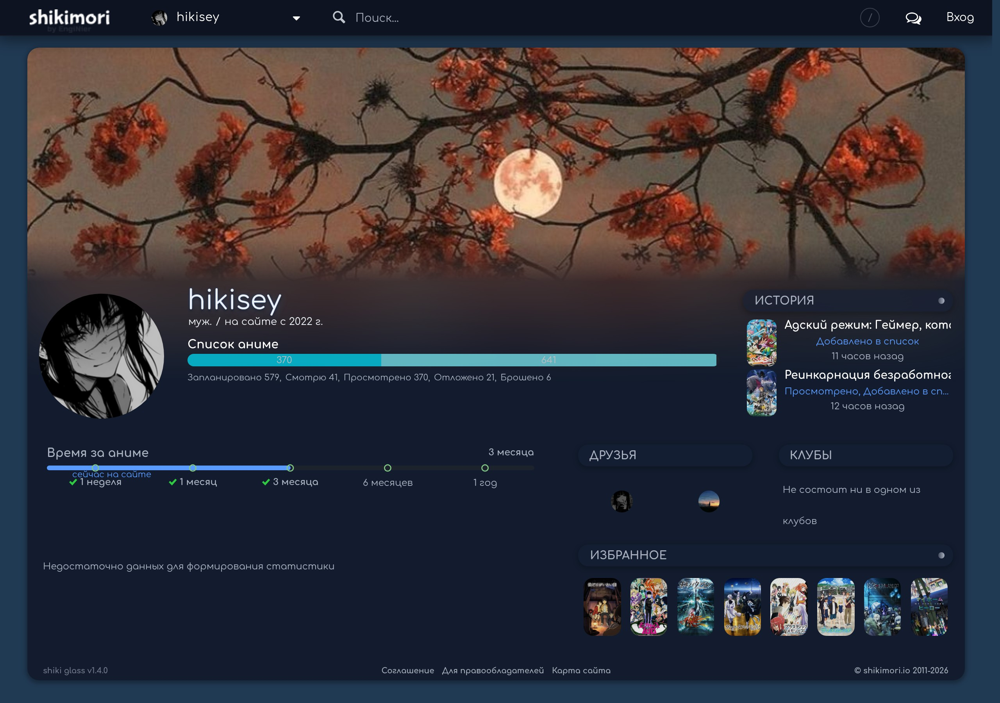
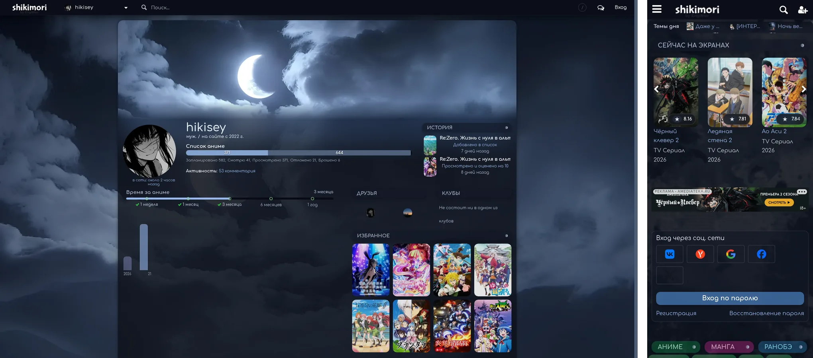
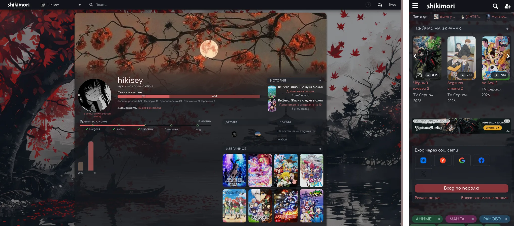
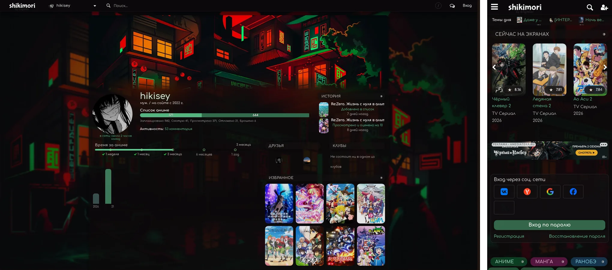
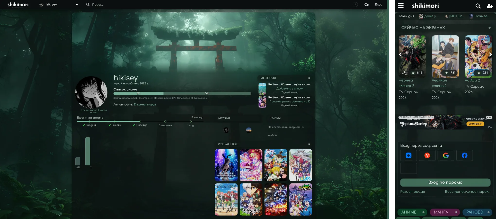
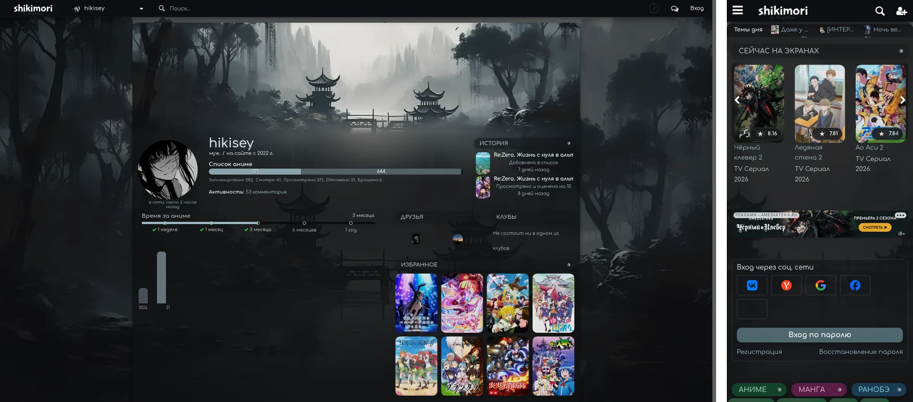
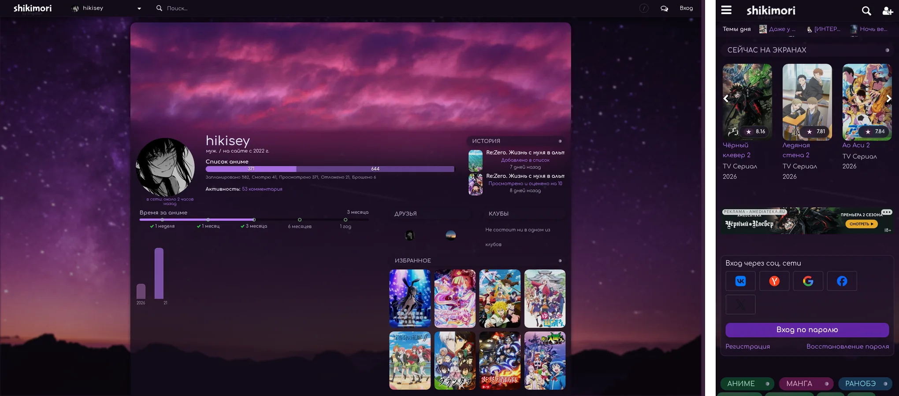

<div align="center">

# shiki glass

Тёмная стеклянная тема для [Шикимори](https://shikimori.io) и [shikimori.rip](https://shikimori.rip)

[](https://github.com/Hikisey/shikimori-theme/releases)


[Установка](#установка) · [Готовые темы](#готовые-темы) · [Цвета и обои](#цвета-обои-и-баннер) · [Если что-то не так](#если-что-то-пошло-не-так) · [Обновления](https://github.com/Hikisey/shikimori-theme/releases)



</div>

Мягкое стекло, ночные облака и лунно-голубой акцент (тема по умолчанию — «лунная ночь», ещё пять — в [готовых темах](#готовые-темы)). Одни и те же файлы работают на обоих сайтах, на компьютере и на телефоне. Цвет акцента, обои и баннер профиля меняются парой строк.

<table>
  <tr>
    <td width="33%"><p align="center"><sub>Главная</sub></p></td>
    <td width="33%"><p align="center"><sub>Каталог</sub></p></td>
    <td width="33%"><p align="center"><sub>Профиль</sub></p></td>
  </tr>
</table>

## Установка

1. На Шикимори откройте профиль → **Настройки** → **Внешний вид сайта**.
2. Откройте [site.css](https://github.com/Hikisey/shikimori-theme/blob/v1.7.21/site.css), скопируйте его **целиком** (кнопка копирования справа над кодом) и вставьте в поле стиля вместо того, что там было.
3. Нажмите **Сохранить** и обновите страницу с очисткой кеша: <kbd>Ctrl</kbd>+<kbd>Shift</kbd>+<kbd>R</kbd>.

В site.css лежат строки подключения темы и блок настроек: обои, баннер профиля и цвета.

> [!TIP]
> **Обновление.** Когда выйдет новая версия, замените в четырёх строках `@import` номер `v1.7.21` на новый со страницы [Releases](https://github.com/Hikisey/shikimori-theme/releases). Свои цвета и обои можно не трогать.
>
> С v1.7.21 тема по умолчанию — «лунная ночь». Если вы просто меняете номер версии, ваш блок «Палитра» остаётся прежним и тема выглядит как раньше (алая). Чтобы перейти на «лунную ночь» или другую тему, скопируйте её `site.css` целиком заново; прежняя алая — тема «алая» в [готовых темах](#готовые-темы).
>
> С v1.7.16 в site.css ровно четыре строки `@import`: тёмный редактор кода (`CodeMirror_dark.css` от css-club) встроен в тему. Если у вас осталась пятая строка с `css-club.web.app/css/CodeMirror_dark.css`, удалите её: на shikimori.io из-за неё появлялось «Не удалось импортировать следующие стили».

> [!NOTE]
> Частей четыре, потому что Шикимори не принимает файл больше ~230 КБ, а вся тема весит около 600 КБ.

## Готовые темы

Каждая тема — это готовый `site.css` целиком: свои обои для компьютера и телефона, баннер профиля и подобранная палитра. Под скриншотом нажмите «CSS-код темы», чтобы скопировать стиль. Вставляется так же, как основная тема (см. «Установка»); обновляется тоже заменой номера версии. Файлы тем лежат в папке [`themes/`](themes).

<!-- themes:start -->

### лунная ночь (по умолчанию)

Месяц в ночных облаках, на телефоне — вороны и газетная бумага; синее стекло и лунно-голубой акцент. Это обычный <code>site.css</code> из корня репозитория (раздел «Установка»).



<sub>Источник: облака — автор неизвестен (Pinterest), увеличены до 4K нейросетью Real-ESRGAN; вороны — Telegram-канал [@wallpaper_hd_svstmrn](https://t.me/wallpaper_hd_svstmrn).</sub>

<details>
<summary>CSS-код темы «лунная ночь»</summary>

```css
/* shiki glass v1.7.21, тема «лунная ночь» — тема и обновления: https://github.com/Hikisey/shikimori-theme */
/* Ровно 4 @import — 4 части темы: shikimori.io подключает только 4 первых @import.
   Тёмный редактор кода (CodeMirror_dark) и свои постеры персонажей уже внутри темы,
   отдельные импорты для них не нужны. */
@import url("https://raw.githubusercontent.com/Hikisey/shikimori-theme/v1.7.21/css/part_01.css");
@import url("https://raw.githubusercontent.com/Hikisey/shikimori-theme/v1.7.21/css/part_02.css");
@import url("https://raw.githubusercontent.com/Hikisey/shikimori-theme/v1.7.21/css/part_03.css");
@import url("https://raw.githubusercontent.com/Hikisey/shikimori-theme/v1.7.21/css/part_04.css");

/* Если какая-то из четырёх частей не загрузилась (Шикимори хранит ошибку 8 часов),
   в левом нижнем углу появится надпись с её номером. Тогда откройте
   https://shikimori.io/tests/reset_styles_cache (или shikimori.rip/tests/reset_styles_cache)
   и вставьте туда адрес этой части. Когда всё загрузилось, надписи нет. */
@media screen and (min-width: 1px) {
  html::after {
    content: var(--sg-p1, "shiki glass: не загрузилась часть 1. ") var(--sg-p2, "shiki glass: не загрузилась часть 2. ") var(--sg-p3, "shiki glass: не загрузилась часть 3. ") var(--sg-p4, "shiki glass: не загрузилась часть 4. ");
    position: fixed;
    left: 8px;
    bottom: 8px;
    z-index: 2147483647;
    max-width: calc(100vw - 16px);
    color: #ff8080;
    font: bold 12px/1.4 sans-serif;
    text-shadow: 0 1px 2px #000;
    pointer-events: none;
  }
}

/* ===================== Палитра ===================== */
/* Четыре группы: АКЦЕНТ, ФОН, СТЕКЛО, ТЕКСТ. Всё остальное тема считает сама:
   поменяйте --accent — и перекрасится всё «красное» (кнопки, ник, ссылки под курсором).
   Цвета пишутся тремя числами R, G, B через запятую (без rgb()).
   Подобрать цвет и узнать его числа можно в любой «color picker».
   Обёртку @media не удаляйте, иначе Шикимори применит стиль только на широких экранах. */
@media screen and (min-width: 1px) {
  html:root {
    /* Акцент */
    --accent: 150, 184, 236;           /* главный цвет темы: ссылки, значки, подсветка; из него же кнопки и ник */
    --link: var(--accent);             /* цвет ссылок; можно задать отдельно, например 120, 170, 255 */

    /* Фон */
    --bg-image: url("https://raw.githubusercontent.com/Hikisey/shikimori-theme/v1.7.21/themes/moon/bg.webp");  /* обои на ПК (Шикимори всё равно загружает их через свой прокси картинок — и с //, и с https://) */
    --bg-image-mobile: url("https://raw.githubusercontent.com/Hikisey/shikimori-theme/v1.7.21/themes/moon/bg_m.webp");  /* обои на телефоне */
    --bg-color: 75, 95, 123;         /* цвет под обоями, пока они грузятся (средний тон обоев) */
    --bg-color-mobile: 62, 74, 92;  /* то же на телефоне */
    --bg-zoom: 1;                   /* приближение обоев на ПК, 1 — без зума */
    --bg-blur: 0px;                    /* размытие обоев на ПК, например 4px */
    --bg-blur-mobile: 1.5px;           /* размытие обоев на телефоне */
    --bg-dim: .4;                      /* затемнение обоев: 0 — нет, 1 — совсем тёмные; для светлых обоев — .7 */
    --profile-banner: url("https://raw.githubusercontent.com/Hikisey/shikimori-theme/v1.7.21/themes/moon/banner.webp");  /* баннер в профиле */
    --profile-banner-height: 300px;    /* высота баннера; картинка не растягивается, лишнее обрезается */
    --profile-banner-height-mobile: 170px; /* высота баннера на телефоне (аватар и ник ложатся на его нижний край) */
    --profile-banner-glow: .5;         /* яркость свечения под баннером (цвет берётся из картинки), 0 — выключить */
    --profile-banner-position: center; /* какую часть картинки показывать: center, top, bottom или, например, 50% 30% */

    /* Стекло (блоки, меню, окна) */
    --glass: 18, 24, 38;               /* цвет стекла; тёмные оттенки панели, меню и окон считаются из него. Чем темнее, тем лучше читается текст */
    --glass-light: 255, 255, 255;      /* рамки и блики на стекле */
    --glass-blur: 5px;                 /* размытие под стеклом (телефон, стрелки лент) */

    /* Текст */
    --text: 232, 238, 250;             /* основной текст — мягко-белый */
    --text-2: 170, 182, 204;           /* второстепенный текст и подписи */
    --text-3: 138, 150, 172;           /* приглушённый текст: даты, счётчики */
    --text-strong: 255, 255, 255;      /* самый яркий текст (заголовки карточек, текст на кнопках) */

    /* Оценки и шкалы (можно не трогать) */
    --very-high-rating: 129, 199, 132; /* очень высокая */
    --high-rating: 156, 204, 101;      /* высокая */
    --average-rating: 255, 202, 40;    /* средняя */
    --small-rating: 239, 108, 108;     /* низкая */
    --time-filled: var(--accent);      /* шкала времени: заполненная часть */
    --time-empty: 30, 38, 54;          /* шкала времени: пустая часть */
    --anime-inprocess: var(--accent);  /* аниме: смотрю (по умолчанию из акцента) */
    --anime-complete: var(--accent);   /* аниме: просмотрено */
    --manga-inprocess: var(--accent);  /* манга: читаю */
    --manga-complete: var(--accent);   /* манга: прочитано */
  }
}

/* ===================== Дополнительно ===================== */
/* Чтобы включить блок, удалите /*коментарий/* он убирается удалением слеша с звездочкой с двух сторон */

/* Полупрозрачная рамка вокруг страницы:
@media (min-width: 1200px) {
  .l-page { outline: 20px solid rgba(255, 255, 255, 0.3); margin-bottom: 20px; }
}
*/

/* Вернуть всплывающие карточки с описанием при наведении на аниме (окно с крестиком):*/
/*
.tooltip { visibility: visible !important; opacity: 1 !important; pointer-events: auto !important; }
.tooltip * { visibility: inherit !important; pointer-events: auto !important; }
*/
```

</details>

### алая

Графит и алый акцент; до v1.7.21 это была тема по умолчанию.



<sub>Источник: обои — как в прежней основной теме; баннер — Pinterest, автор неизвестен.</sub>

<details>
<summary>CSS-код темы «алая»</summary>

```css
/* shiki glass v1.7.21, тема «алая» — тема и обновления: https://github.com/Hikisey/shikimori-theme */
/* Ровно 4 @import — 4 части темы: shikimori.io подключает только 4 первых @import.
   Тёмный редактор кода (CodeMirror_dark) и свои постеры персонажей уже внутри темы,
   отдельные импорты для них не нужны. */
@import url("https://raw.githubusercontent.com/Hikisey/shikimori-theme/v1.7.21/css/part_01.css");
@import url("https://raw.githubusercontent.com/Hikisey/shikimori-theme/v1.7.21/css/part_02.css");
@import url("https://raw.githubusercontent.com/Hikisey/shikimori-theme/v1.7.21/css/part_03.css");
@import url("https://raw.githubusercontent.com/Hikisey/shikimori-theme/v1.7.21/css/part_04.css");

/* Если какая-то из четырёх частей не загрузилась (Шикимори хранит ошибку 8 часов),
   в левом нижнем углу появится надпись с её номером. Тогда откройте
   https://shikimori.io/tests/reset_styles_cache (или shikimori.rip/tests/reset_styles_cache)
   и вставьте туда адрес этой части. Когда всё загрузилось, надписи нет. */
@media screen and (min-width: 1px) {
  html::after {
    content: var(--sg-p1, "shiki glass: не загрузилась часть 1. ") var(--sg-p2, "shiki glass: не загрузилась часть 2. ") var(--sg-p3, "shiki glass: не загрузилась часть 3. ") var(--sg-p4, "shiki glass: не загрузилась часть 4. ");
    position: fixed;
    left: 8px;
    bottom: 8px;
    z-index: 2147483647;
    max-width: calc(100vw - 16px);
    color: #ff8080;
    font: bold 12px/1.4 sans-serif;
    text-shadow: 0 1px 2px #000;
    pointer-events: none;
  }
}

/* ===================== Палитра ===================== */
/* Четыре группы: АКЦЕНТ, ФОН, СТЕКЛО, ТЕКСТ. Всё остальное тема считает сама:
   поменяйте --accent — и перекрасится всё «красное» (кнопки, ник, ссылки под курсором).
   Цвета пишутся тремя числами R, G, B через запятую (без rgb()).
   Подобрать цвет и узнать его числа можно в любой «color picker».
   Обёртку @media не удаляйте, иначе Шикимори применит стиль только на широких экранах. */
@media screen and (min-width: 1px) {
  html:root {
    /* Акцент */
    --accent: 232, 108, 108;           /* главный цвет темы: ссылки, значки, подсветка; из него же кнопки и ник */
    --link: var(--accent);             /* цвет ссылок; можно задать отдельно, например 120, 170, 255 */

    /* Фон */
    --bg-image: url("https://raw.githubusercontent.com/Hikisey/shikimori-theme/v1.7.21/themes/crimson/bg.webp");  /* обои на ПК (Шикимори всё равно загружает их через свой прокси картинок — и с //, и с https://) */
    --bg-image-mobile: url("https://raw.githubusercontent.com/Hikisey/shikimori-theme/v1.7.21/themes/crimson/bg_m.webp");  /* обои на телефоне */
    --bg-color: 151, 128, 128;         /* цвет под обоями, пока они грузятся (средний тон обоев) */
    --bg-color-mobile: 167, 148, 145;  /* то же на телефоне */
    --bg-zoom: 1.08;                   /* приближение обоев на ПК, 1 — без зума */
    --bg-blur: 0px;                    /* размытие обоев на ПК, например 4px */
    --bg-blur-mobile: 1.5px;           /* размытие обоев на телефоне */
    --bg-dim: .5;                      /* затемнение обоев: 0 — нет, 1 — совсем тёмные; для светлых обоев — .7 */
    --profile-banner: url("https://raw.githubusercontent.com/Hikisey/shikimori-theme/v1.7.21/themes/crimson/banner.webp");  /* баннер в профиле */
    --profile-banner-height: 300px;    /* высота баннера; картинка не растягивается, лишнее обрезается */
    --profile-banner-height-mobile: 170px; /* высота баннера на телефоне (аватар и ник ложатся на его нижний край) */
    --profile-banner-glow: .5;         /* яркость свечения под баннером (цвет берётся из картинки), 0 — выключить */
    --profile-banner-position: center; /* какую часть картинки показывать: center, top, bottom или, например, 50% 30% */

    /* Стекло (блоки, меню, окна) */
    --glass: 30, 34, 42;               /* цвет стекла; тёмные оттенки панели, меню и окон считаются из него. Чем темнее, тем лучше читается текст */
    --glass-light: 255, 255, 255;      /* рамки и блики на стекле */
    --glass-blur: 5px;                 /* размытие под стеклом (телефон, стрелки лент) */

    /* Текст */
    --text: 236, 240, 247;             /* основной текст — мягко-белый */
    --text-2: 170, 178, 192;           /* второстепенный текст и подписи */
    --text-3: 140, 148, 160;           /* приглушённый текст: даты, счётчики */
    --text-strong: 255, 255, 255;      /* самый яркий текст (заголовки карточек, текст на кнопках) */

    /* Оценки и шкалы (можно не трогать) */
    --very-high-rating: 129, 199, 132; /* очень высокая */
    --high-rating: 156, 204, 101;      /* высокая */
    --average-rating: 255, 202, 40;    /* средняя */
    --small-rating: 239, 108, 108;     /* низкая */
    --time-filled: var(--accent);      /* шкала времени: заполненная часть */
    --time-empty: 34, 38, 46;          /* шкала времени: пустая часть */
    --anime-inprocess: var(--accent);  /* аниме: смотрю (по умолчанию из акцента) */
    --anime-complete: var(--accent);   /* аниме: просмотрено */
    --manga-inprocess: var(--accent);  /* манга: читаю */
    --manga-complete: var(--accent);   /* манга: прочитано */
  }
}

/* ===================== Дополнительно ===================== */
/* Чтобы включить блок, удалите /*коментарий/* он убирается удалением слеша с звездочкой с двух сторон */

/* Полупрозрачная рамка вокруг страницы:
@media (min-width: 1200px) {
  .l-page { outline: 20px solid rgba(255, 255, 255, 0.3); margin-bottom: 20px; }
}
*/

/* Вернуть всплывающие карточки с описанием при наведении на аниме (окно с крестиком):*/
/*
.tooltip { visibility: visible !important; opacity: 1 !important; pointer-events: auto !important; }
.tooltip * { visibility: inherit !important; pointer-events: auto !important; }
*/
```

</details>

### неоновый квартал

Ночной квартал в неоне: тёплый тёмный фон и мятный акцент.



<sub>Источник: обои «Neon Shallows», автор неизвестен (найдены на Pinterest и wallpapersden.com).</sub>

<details>
<summary>CSS-код темы «неоновый квартал»</summary>

```css
/* shiki glass v1.7.21, тема «неоновый квартал» — тема и обновления: https://github.com/Hikisey/shikimori-theme */
/* Ровно 4 @import — 4 части темы: shikimori.io подключает только 4 первых @import.
   Тёмный редактор кода (CodeMirror_dark) и свои постеры персонажей уже внутри темы,
   отдельные импорты для них не нужны. */
@import url("https://raw.githubusercontent.com/Hikisey/shikimori-theme/v1.7.21/css/part_01.css");
@import url("https://raw.githubusercontent.com/Hikisey/shikimori-theme/v1.7.21/css/part_02.css");
@import url("https://raw.githubusercontent.com/Hikisey/shikimori-theme/v1.7.21/css/part_03.css");
@import url("https://raw.githubusercontent.com/Hikisey/shikimori-theme/v1.7.21/css/part_04.css");

/* Если какая-то из четырёх частей не загрузилась (Шикимори хранит ошибку 8 часов),
   в левом нижнем углу появится надпись с её номером. Тогда откройте
   https://shikimori.io/tests/reset_styles_cache (или shikimori.rip/tests/reset_styles_cache)
   и вставьте туда адрес этой части. Когда всё загрузилось, надписи нет. */
@media screen and (min-width: 1px) {
  html::after {
    content: var(--sg-p1, "shiki glass: не загрузилась часть 1. ") var(--sg-p2, "shiki glass: не загрузилась часть 2. ") var(--sg-p3, "shiki glass: не загрузилась часть 3. ") var(--sg-p4, "shiki glass: не загрузилась часть 4. ");
    position: fixed;
    left: 8px;
    bottom: 8px;
    z-index: 2147483647;
    max-width: calc(100vw - 16px);
    color: #ff8080;
    font: bold 12px/1.4 sans-serif;
    text-shadow: 0 1px 2px #000;
    pointer-events: none;
  }
}

/* ===================== Палитра ===================== */
/* Четыре группы: АКЦЕНТ, ФОН, СТЕКЛО, ТЕКСТ. Всё остальное тема считает сама:
   поменяйте --accent — и перекрасится всё «красное» (кнопки, ник, ссылки под курсором).
   Цвета пишутся тремя числами R, G, B через запятую (без rgb()).
   Подобрать цвет и узнать его числа можно в любой «color picker».
   Обёртку @media не удаляйте, иначе Шикимори применит стиль только на широких экранах. */
@media screen and (min-width: 1px) {
  html:root {
    /* Акцент */
    --accent: 96, 204, 146;           /* главный цвет темы: ссылки, значки, подсветка; из него же кнопки и ник */
    --link: var(--accent);             /* цвет ссылок; можно задать отдельно, например 120, 170, 255 */

    /* Фон */
    --bg-image: url("https://raw.githubusercontent.com/Hikisey/shikimori-theme/v1.7.21/themes/neon/bg.webp");  /* обои на ПК (Шикимори всё равно загружает их через свой прокси картинок — и с //, и с https://) */
    --bg-image-mobile: url("https://raw.githubusercontent.com/Hikisey/shikimori-theme/v1.7.21/themes/neon/bg_m.webp");  /* обои на телефоне */
    --bg-color: 34, 21, 17;         /* цвет под обоями, пока они грузятся (средний тон обоев) */
    --bg-color-mobile: 30, 20, 17;  /* то же на телефоне */
    --bg-zoom: 1;                   /* приближение обоев на ПК, 1 — без зума */
    --bg-blur: 2px;                    /* размытие обоев на ПК, например 4px */
    --bg-blur-mobile: 1.5px;           /* размытие обоев на телефоне */
    --bg-dim: .55;                      /* затемнение обоев: 0 — нет, 1 — совсем тёмные; для светлых обоев — .7 */
    --profile-banner: url("https://raw.githubusercontent.com/Hikisey/shikimori-theme/v1.7.21/themes/neon/banner.webp");  /* баннер в профиле */
    --profile-banner-height: 300px;    /* высота баннера; картинка не растягивается, лишнее обрезается */
    --profile-banner-height-mobile: 170px; /* высота баннера на телефоне (аватар и ник ложатся на его нижний край) */
    --profile-banner-glow: .5;         /* яркость свечения под баннером (цвет берётся из картинки), 0 — выключить */
    --profile-banner-position: center; /* какую часть картинки показывать: center, top, bottom или, например, 50% 30% */

    /* Стекло (блоки, меню, окна) */
    --glass: 18, 16, 17;               /* цвет стекла; тёмные оттенки панели, меню и окон считаются из него. Чем темнее, тем лучше читается текст */
    --glass-light: 255, 255, 255;      /* рамки и блики на стекле */
    --glass-blur: 5px;                 /* размытие под стеклом (телефон, стрелки лент) */

    /* Текст */
    --text: 238, 236, 234;             /* основной текст — мягко-белый */
    --text-2: 180, 174, 172;           /* второстепенный текст и подписи */
    --text-3: 146, 140, 138;           /* приглушённый текст: даты, счётчики */
    --text-strong: 255, 255, 255;      /* самый яркий текст (заголовки карточек, текст на кнопках) */

    /* Оценки и шкалы (можно не трогать) */
    --very-high-rating: 129, 199, 132; /* очень высокая */
    --high-rating: 156, 204, 101;      /* высокая */
    --average-rating: 255, 202, 40;    /* средняя */
    --small-rating: 239, 108, 108;     /* низкая */
    --time-filled: var(--accent);      /* шкала времени: заполненная часть */
    --time-empty: 34, 30, 30;          /* шкала времени: пустая часть */
    --anime-inprocess: var(--accent);  /* аниме: смотрю (по умолчанию из акцента) */
    --anime-complete: var(--accent);   /* аниме: просмотрено */
    --manga-inprocess: var(--accent);  /* манга: читаю */
    --manga-complete: var(--accent);   /* манга: прочитано */
  }
}

/* ===================== Дополнительно ===================== */
/* Чтобы включить блок, удалите /*коментарий/* он убирается удалением слеша с звездочкой с двух сторон */

/* Полупрозрачная рамка вокруг страницы:
@media (min-width: 1200px) {
  .l-page { outline: 20px solid rgba(255, 255, 255, 0.3); margin-bottom: 20px; }
}
*/

/* Вернуть всплывающие карточки с описанием при наведении на аниме (окно с крестиком):*/
/*
.tooltip { visibility: visible !important; opacity: 1 !important; pointer-events: auto !important; }
.tooltip * { visibility: inherit !important; pointer-events: auto !important; }
*/
```

</details>

### туманные тории

Ворота-тории в туманном лесу: зелёное стекло и шалфейный акцент.



<sub>Источник: обои — автор неизвестен (Pinterest, Reddit «Serene Nature Torii Arch»), увеличены до 4K нейросетью Real-ESRGAN.</sub>

<details>
<summary>CSS-код темы «туманные тории»</summary>

```css
/* shiki glass v1.7.21, тема «туманные тории» — тема и обновления: https://github.com/Hikisey/shikimori-theme */
/* Ровно 4 @import — 4 части темы: shikimori.io подключает только 4 первых @import.
   Тёмный редактор кода (CodeMirror_dark) и свои постеры персонажей уже внутри темы,
   отдельные импорты для них не нужны. */
@import url("https://raw.githubusercontent.com/Hikisey/shikimori-theme/v1.7.21/css/part_01.css");
@import url("https://raw.githubusercontent.com/Hikisey/shikimori-theme/v1.7.21/css/part_02.css");
@import url("https://raw.githubusercontent.com/Hikisey/shikimori-theme/v1.7.21/css/part_03.css");
@import url("https://raw.githubusercontent.com/Hikisey/shikimori-theme/v1.7.21/css/part_04.css");

/* Если какая-то из четырёх частей не загрузилась (Шикимори хранит ошибку 8 часов),
   в левом нижнем углу появится надпись с её номером. Тогда откройте
   https://shikimori.io/tests/reset_styles_cache (или shikimori.rip/tests/reset_styles_cache)
   и вставьте туда адрес этой части. Когда всё загрузилось, надписи нет. */
@media screen and (min-width: 1px) {
  html::after {
    content: var(--sg-p1, "shiki glass: не загрузилась часть 1. ") var(--sg-p2, "shiki glass: не загрузилась часть 2. ") var(--sg-p3, "shiki glass: не загрузилась часть 3. ") var(--sg-p4, "shiki glass: не загрузилась часть 4. ");
    position: fixed;
    left: 8px;
    bottom: 8px;
    z-index: 2147483647;
    max-width: calc(100vw - 16px);
    color: #ff8080;
    font: bold 12px/1.4 sans-serif;
    text-shadow: 0 1px 2px #000;
    pointer-events: none;
  }
}

/* ===================== Палитра ===================== */
/* Четыре группы: АКЦЕНТ, ФОН, СТЕКЛО, ТЕКСТ. Всё остальное тема считает сама:
   поменяйте --accent — и перекрасится всё «красное» (кнопки, ник, ссылки под курсором).
   Цвета пишутся тремя числами R, G, B через запятую (без rgb()).
   Подобрать цвет и узнать его числа можно в любой «color picker».
   Обёртку @media не удаляйте, иначе Шикимори применит стиль только на широких экранах. */
@media screen and (min-width: 1px) {
  html:root {
    /* Акцент */
    --accent: 134, 196, 168;           /* главный цвет темы: ссылки, значки, подсветка; из него же кнопки и ник */
    --link: var(--accent);             /* цвет ссылок; можно задать отдельно, например 120, 170, 255 */

    /* Фон */
    --bg-image: url("https://raw.githubusercontent.com/Hikisey/shikimori-theme/v1.7.21/themes/torii/bg.webp");  /* обои на ПК (Шикимори всё равно загружает их через свой прокси картинок — и с //, и с https://) */
    --bg-image-mobile: url("https://raw.githubusercontent.com/Hikisey/shikimori-theme/v1.7.21/themes/torii/bg_m.webp");  /* обои на телефоне */
    --bg-color: 54, 94, 80;         /* цвет под обоями, пока они грузятся (средний тон обоев) */
    --bg-color-mobile: 48, 86, 72;  /* то же на телефоне */
    --bg-zoom: 1;                   /* приближение обоев на ПК, 1 — без зума */
    --bg-blur: 0px;                    /* размытие обоев на ПК, например 4px */
    --bg-blur-mobile: 1.5px;           /* размытие обоев на телефоне */
    --bg-dim: .45;                      /* затемнение обоев: 0 — нет, 1 — совсем тёмные; для светлых обоев — .7 */
    --profile-banner: url("https://raw.githubusercontent.com/Hikisey/shikimori-theme/v1.7.21/themes/torii/banner.webp");  /* баннер в профиле */
    --profile-banner-height: 300px;    /* высота баннера; картинка не растягивается, лишнее обрезается */
    --profile-banner-height-mobile: 170px; /* высота баннера на телефоне (аватар и ник ложатся на его нижний край) */
    --profile-banner-glow: .5;         /* яркость свечения под баннером (цвет берётся из картинки), 0 — выключить */
    --profile-banner-position: center; /* какую часть картинки показывать: center, top, bottom или, например, 50% 30% */

    /* Стекло (блоки, меню, окна) */
    --glass: 16, 26, 24;               /* цвет стекла; тёмные оттенки панели, меню и окон считаются из него. Чем темнее, тем лучше читается текст */
    --glass-light: 255, 255, 255;      /* рамки и блики на стекле */
    --glass-blur: 5px;                 /* размытие под стеклом (телефон, стрелки лент) */

    /* Текст */
    --text: 234, 242, 238;             /* основной текст — мягко-белый */
    --text-2: 172, 188, 182;           /* второстепенный текст и подписи */
    --text-3: 140, 156, 150;           /* приглушённый текст: даты, счётчики */
    --text-strong: 255, 255, 255;      /* самый яркий текст (заголовки карточек, текст на кнопках) */

    /* Оценки и шкалы (можно не трогать) */
    --very-high-rating: 129, 199, 132; /* очень высокая */
    --high-rating: 156, 204, 101;      /* высокая */
    --average-rating: 255, 202, 40;    /* средняя */
    --small-rating: 239, 108, 108;     /* низкая */
    --time-filled: var(--accent);      /* шкала времени: заполненная часть */
    --time-empty: 28, 40, 37;          /* шкала времени: пустая часть */
    --anime-inprocess: var(--accent);  /* аниме: смотрю (по умолчанию из акцента) */
    --anime-complete: var(--accent);   /* аниме: просмотрено */
    --manga-inprocess: var(--accent);  /* манга: читаю */
    --manga-complete: var(--accent);   /* манга: прочитано */
  }
}

/* ===================== Дополнительно ===================== */
/* Чтобы включить блок, удалите /*коментарий/* он убирается удалением слеша с звездочкой с двух сторон */

/* Полупрозрачная рамка вокруг страницы:
@media (min-width: 1200px) {
  .l-page { outline: 20px solid rgba(255, 255, 255, 0.3); margin-bottom: 20px; }
}
*/

/* Вернуть всплывающие карточки с описанием при наведении на аниме (окно с крестиком):*/
/*
.tooltip { visibility: visible !important; opacity: 1 !important; pointer-events: auto !important; }
.tooltip * { visibility: inherit !important; pointer-events: auto !important; }
*/
```

</details>

### туманное озеро

Пагоды у туманного озера: графитовое стекло и серо-бирюзовый акцент.



<sub>Источник: обои — qbuer (Midjourney), увеличены до 4K нейросетью Real-ESRGAN.</sub>

<details>
<summary>CSS-код темы «туманное озеро»</summary>

```css
/* shiki glass v1.7.21, тема «туманное озеро» — тема и обновления: https://github.com/Hikisey/shikimori-theme */
/* Ровно 4 @import — 4 части темы: shikimori.io подключает только 4 первых @import.
   Тёмный редактор кода (CodeMirror_dark) и свои постеры персонажей уже внутри темы,
   отдельные импорты для них не нужны. */
@import url("https://raw.githubusercontent.com/Hikisey/shikimori-theme/v1.7.21/css/part_01.css");
@import url("https://raw.githubusercontent.com/Hikisey/shikimori-theme/v1.7.21/css/part_02.css");
@import url("https://raw.githubusercontent.com/Hikisey/shikimori-theme/v1.7.21/css/part_03.css");
@import url("https://raw.githubusercontent.com/Hikisey/shikimori-theme/v1.7.21/css/part_04.css");

/* Если какая-то из четырёх частей не загрузилась (Шикимори хранит ошибку 8 часов),
   в левом нижнем углу появится надпись с её номером. Тогда откройте
   https://shikimori.io/tests/reset_styles_cache (или shikimori.rip/tests/reset_styles_cache)
   и вставьте туда адрес этой части. Когда всё загрузилось, надписи нет. */
@media screen and (min-width: 1px) {
  html::after {
    content: var(--sg-p1, "shiki glass: не загрузилась часть 1. ") var(--sg-p2, "shiki glass: не загрузилась часть 2. ") var(--sg-p3, "shiki glass: не загрузилась часть 3. ") var(--sg-p4, "shiki glass: не загрузилась часть 4. ");
    position: fixed;
    left: 8px;
    bottom: 8px;
    z-index: 2147483647;
    max-width: calc(100vw - 16px);
    color: #ff8080;
    font: bold 12px/1.4 sans-serif;
    text-shadow: 0 1px 2px #000;
    pointer-events: none;
  }
}

/* ===================== Палитра ===================== */
/* Четыре группы: АКЦЕНТ, ФОН, СТЕКЛО, ТЕКСТ. Всё остальное тема считает сама:
   поменяйте --accent — и перекрасится всё «красное» (кнопки, ник, ссылки под курсором).
   Цвета пишутся тремя числами R, G, B через запятую (без rgb()).
   Подобрать цвет и узнать его числа можно в любой «color picker».
   Обёртку @media не удаляйте, иначе Шикимори применит стиль только на широких экранах. */
@media screen and (min-width: 1px) {
  html:root {
    /* Акцент */
    --accent: 156, 186, 196;           /* главный цвет темы: ссылки, значки, подсветка; из него же кнопки и ник */
    --link: var(--accent);             /* цвет ссылок; можно задать отдельно, например 120, 170, 255 */

    /* Фон */
    --bg-image: url("https://raw.githubusercontent.com/Hikisey/shikimori-theme/v1.7.21/themes/lake/bg.webp");  /* обои на ПК (Шикимори всё равно загружает их через свой прокси картинок — и с //, и с https://) */
    --bg-image-mobile: url("https://raw.githubusercontent.com/Hikisey/shikimori-theme/v1.7.21/themes/lake/bg_m.webp");  /* обои на телефоне */
    --bg-color: 93, 98, 99;         /* цвет под обоями, пока они грузятся (средний тон обоев) */
    --bg-color-mobile: 93, 98, 99;  /* то же на телефоне */
    --bg-zoom: 1;                   /* приближение обоев на ПК, 1 — без зума */
    --bg-blur: 0px;                    /* размытие обоев на ПК, например 4px */
    --bg-blur-mobile: 1.5px;           /* размытие обоев на телефоне */
    --bg-dim: .5;                      /* затемнение обоев: 0 — нет, 1 — совсем тёмные; для светлых обоев — .7 */
    --profile-banner: url("https://raw.githubusercontent.com/Hikisey/shikimori-theme/v1.7.21/themes/lake/banner.webp");  /* баннер в профиле */
    --profile-banner-height: 300px;    /* высота баннера; картинка не растягивается, лишнее обрезается */
    --profile-banner-height-mobile: 170px; /* высота баннера на телефоне (аватар и ник ложатся на его нижний край) */
    --profile-banner-glow: .5;         /* яркость свечения под баннером (цвет берётся из картинки), 0 — выключить */
    --profile-banner-position: center; /* какую часть картинки показывать: center, top, bottom или, например, 50% 30% */

    /* Стекло (блоки, меню, окна) */
    --glass: 22, 24, 27;               /* цвет стекла; тёмные оттенки панели, меню и окон считаются из него. Чем темнее, тем лучше читается текст */
    --glass-light: 255, 255, 255;      /* рамки и блики на стекле */
    --glass-blur: 5px;                 /* размытие под стеклом (телефон, стрелки лент) */

    /* Текст */
    --text: 236, 238, 238;             /* основной текст — мягко-белый */
    --text-2: 176, 180, 182;           /* второстепенный текст и подписи */
    --text-3: 144, 148, 150;           /* приглушённый текст: даты, счётчики */
    --text-strong: 255, 255, 255;      /* самый яркий текст (заголовки карточек, текст на кнопках) */

    /* Оценки и шкалы (можно не трогать) */
    --very-high-rating: 129, 199, 132; /* очень высокая */
    --high-rating: 156, 204, 101;      /* высокая */
    --average-rating: 255, 202, 40;    /* средняя */
    --small-rating: 239, 108, 108;     /* низкая */
    --time-filled: var(--accent);      /* шкала времени: заполненная часть */
    --time-empty: 34, 37, 40;          /* шкала времени: пустая часть */
    --anime-inprocess: var(--accent);  /* аниме: смотрю (по умолчанию из акцента) */
    --anime-complete: var(--accent);   /* аниме: просмотрено */
    --manga-inprocess: var(--accent);  /* манга: читаю */
    --manga-complete: var(--accent);   /* манга: прочитано */
  }
}

/* ===================== Дополнительно ===================== */
/* Чтобы включить блок, удалите /*коментарий/* он убирается удалением слеша с звездочкой с двух сторон */

/* Полупрозрачная рамка вокруг страницы:
@media (min-width: 1200px) {
  .l-page { outline: 20px solid rgba(255, 255, 255, 0.3); margin-bottom: 20px; }
}
*/

/* Вернуть всплывающие карточки с описанием при наведении на аниме (окно с крестиком):*/
/*
.tooltip { visibility: visible !important; opacity: 1 !important; pointer-events: auto !important; }
.tooltip * { visibility: inherit !important; pointer-events: auto !important; }
*/
```

</details>

### фиолетовое небо

Фиолетовое ночное небо и баннер «Пурпурные облака»: фиолетовое стекло и сиреневый акцент.



<sub>Источник: обои «Sublime purple night sky» — Vincentiu Solomon, баннер «Purple and pink cloudy sky» — Jeremy Bishop (оба Unsplash, CC0).</sub>

<details>
<summary>CSS-код темы «фиолетовое небо»</summary>

```css
/* shiki glass v1.7.21, тема «фиолетовое небо» — тема и обновления: https://github.com/Hikisey/shikimori-theme */
/* Ровно 4 @import — 4 части темы: shikimori.io подключает только 4 первых @import.
   Тёмный редактор кода (CodeMirror_dark) и свои постеры персонажей уже внутри темы,
   отдельные импорты для них не нужны. */
@import url("https://raw.githubusercontent.com/Hikisey/shikimori-theme/v1.7.21/css/part_01.css");
@import url("https://raw.githubusercontent.com/Hikisey/shikimori-theme/v1.7.21/css/part_02.css");
@import url("https://raw.githubusercontent.com/Hikisey/shikimori-theme/v1.7.21/css/part_03.css");
@import url("https://raw.githubusercontent.com/Hikisey/shikimori-theme/v1.7.21/css/part_04.css");

/* Если какая-то из четырёх частей не загрузилась (Шикимори хранит ошибку 8 часов),
   в левом нижнем углу появится надпись с её номером. Тогда откройте
   https://shikimori.io/tests/reset_styles_cache (или shikimori.rip/tests/reset_styles_cache)
   и вставьте туда адрес этой части. Когда всё загрузилось, надписи нет. */
@media screen and (min-width: 1px) {
  html::after {
    content: var(--sg-p1, "shiki glass: не загрузилась часть 1. ") var(--sg-p2, "shiki glass: не загрузилась часть 2. ") var(--sg-p3, "shiki glass: не загрузилась часть 3. ") var(--sg-p4, "shiki glass: не загрузилась часть 4. ");
    position: fixed;
    left: 8px;
    bottom: 8px;
    z-index: 2147483647;
    max-width: calc(100vw - 16px);
    color: #ff8080;
    font: bold 12px/1.4 sans-serif;
    text-shadow: 0 1px 2px #000;
    pointer-events: none;
  }
}

/* ===================== Палитра ===================== */
/* Четыре группы: АКЦЕНТ, ФОН, СТЕКЛО, ТЕКСТ. Всё остальное тема считает сама:
   поменяйте --accent — и перекрасится всё «красное» (кнопки, ник, ссылки под курсором).
   Цвета пишутся тремя числами R, G, B через запятую (без rgb()).
   Подобрать цвет и узнать его числа можно в любой «color picker».
   Обёртку @media не удаляйте, иначе Шикимори применит стиль только на широких экранах. */
@media screen and (min-width: 1px) {
  html:root {
    /* Акцент */
    --accent: 186, 122, 255;           /* главный цвет темы: ссылки, значки, подсветка; из него же кнопки и ник */
    --link: var(--accent);             /* цвет ссылок; можно задать отдельно, например 120, 170, 255 */

    /* Фон */
    --bg-image: url("https://raw.githubusercontent.com/Hikisey/shikimori-theme/v1.7.21/themes/purple/bg.webp");  /* обои на ПК (Шикимори всё равно загружает их через свой прокси картинок — и с //, и с https://) */
    --bg-image-mobile: url("https://raw.githubusercontent.com/Hikisey/shikimori-theme/v1.7.21/themes/purple/bg_m.webp");  /* обои на телефоне */
    --bg-color: 64, 30, 66;         /* цвет под обоями, пока они грузятся (средний тон обоев) */
    --bg-color-mobile: 62, 32, 64;  /* то же на телефоне */
    --bg-zoom: 1.08;                   /* приближение обоев на ПК, 1 — без зума */
    --bg-blur: 2px;                    /* размытие обоев на ПК, например 4px */
    --bg-blur-mobile: 1.5px;           /* размытие обоев на телефоне */
    --bg-dim: .38;                      /* затемнение обоев: 0 — нет, 1 — совсем тёмные; для светлых обоев — .7 */
    --profile-banner: url("https://raw.githubusercontent.com/Hikisey/shikimori-theme/v1.7.21/themes/purple/banner.webp");  /* баннер в профиле */
    --profile-banner-height: 300px;    /* высота баннера; картинка не растягивается, лишнее обрезается */
    --profile-banner-height-mobile: 170px; /* высота баннера на телефоне (аватар и ник ложатся на его нижний край) */
    --profile-banner-glow: .5;         /* яркость свечения под баннером (цвет берётся из картинки), 0 — выключить */
    --profile-banner-position: center; /* какую часть картинки показывать: center, top, bottom или, например, 50% 30% */

    /* Стекло (блоки, меню, окна) */
    --glass: 30, 18, 40;               /* цвет стекла; тёмные оттенки панели, меню и окон считаются из него. Чем темнее, тем лучше читается текст */
    --glass-light: 255, 255, 255;      /* рамки и блики на стекле */
    --glass-blur: 8px;                 /* размытие под стеклом (телефон, стрелки лент) */

    /* Текст */
    --text: 240, 236, 247;             /* основной текст — мягко-белый */
    --text-2: 178, 168, 196;           /* второстепенный текст и подписи */
    --text-3: 140, 148, 160;           /* приглушённый текст: даты, счётчики */
    --text-strong: 255, 255, 255;      /* самый яркий текст (заголовки карточек, текст на кнопках) */

    /* Оценки и шкалы (можно не трогать) */
    --very-high-rating: 129, 199, 132; /* очень высокая */
    --high-rating: 156, 204, 101;      /* высокая */
    --average-rating: 255, 202, 40;    /* средняя */
    --small-rating: 239, 108, 108;     /* низкая */
    --time-filled: var(--accent);      /* шкала времени: заполненная часть */
    --time-empty: 34, 38, 46;          /* шкала времени: пустая часть */
    --anime-inprocess: var(--accent);  /* аниме: смотрю (по умолчанию из акцента) */
    --anime-complete: var(--accent);   /* аниме: просмотрено */
    --manga-inprocess: var(--accent);  /* манга: читаю */
    --manga-complete: var(--accent);   /* манга: прочитано */
  }
}

/* ===================== Дополнительно ===================== */
/* Чтобы включить блок, удалите /*коментарий/* он убирается удалением слеша с звездочкой с двух сторон */

/* Полупрозрачная рамка вокруг страницы:
@media (min-width: 1200px) {
  .l-page { outline: 20px solid rgba(255, 255, 255, 0.3); margin-bottom: 20px; }
}
*/

/* Вернуть всплывающие карточки с описанием при наведении на аниме (окно с крестиком):*/
/*
.tooltip { visibility: visible !important; opacity: 1 !important; pointer-events: auto !important; }
.tooltip * { visibility: inherit !important; pointer-events: auto !important; }
*/
```

</details>

<!-- themes:end -->

## Цвета, обои и баннер

По умолчанию тема «лунная ночь» (до v1.7.21 была алая — теперь это готовая тема «алая»). Чтобы перекрасить её, поменяйте значения в блоке «Палитра» в вашем стиле (он пришёл вместе с site.css). Цвет пишется тремя числами через запятую, например `150, 184, 236`. Обычно хватает одного `--accent`: кнопки, ссылки и подсветка перекрасятся сами.

Первые две строки блока (`@media` и `html:root`) не трогайте: без них на телефоне цвета могут не примениться.

| Переменная | Что меняет |
| --- | --- |
| `--accent` | главный цвет: ссылки, кнопки, ник, подсветка |
| `--link` | только ссылки, если нужен отдельный цвет |
| `--bg-image` / `--bg-image-mobile` | обои на компьютере / на телефоне |
| `--bg-color` / `--bg-color-mobile` | цвет под обоями, пока они загружаются |
| `--bg-dim` | затемнение обоев: `0` яркие, `1` совсем тёмные |
| `--bg-blur` / `--bg-blur-mobile` | размытие обоев на компьютере / на телефоне |
| `--profile-banner` | картинка-баннер над профилем |
| `--profile-banner-height` | высота баннера на компьютере |
| `--glass` | цвет стеклянных блоков, меню и окон; чем темнее, тем лучше читается текст |
| `--glass-blur` | сила размытия под стеклом |
| `--text` | основной текст |
| `--text-2` | подписи и второстепенный текст |

Если ставите свои светлые обои, увеличьте `--bg-dim` до `.7`: текст будет читаться лучше. Примеры палитр — в [готовых темах](#готовые-темы).

> [!WARNING]
> В ссылке на свою картинку не должно быть символа `@`, иначе Шикимори её не покажет.

## Если что-то пошло не так

<details>
<summary><b>Тема не загрузилась или осталась старая</b></summary>
<br>

Обновите страницу с очисткой кеша (<kbd>Ctrl</kbd>+<kbd>Shift</kbd>+<kbd>R</kbd>). Если Шикимори пишет «Не удалось импортировать», откройте [сброс кеша стилей](https://shikimori.io/tests/reset_styles_cache) (на rip — [shikimori.rip/tests/reset_styles_cache](https://shikimori.rip/tests/reset_styles_cache)), вставьте туда ссылку из сообщения, сохраните стиль ещё раз и обновите страницу.

Если в левом нижнем углу видна красная надпись «shiki glass: не загрузилась часть N», Шикимори не скачал эту часть (ошибку он помнит 8 часов). Сбросьте кеш для ссылки `part_0N.css` из вашего стиля так же, как выше. Надпись есть только в site.css начиная с v1.7.9.
</details>

<details>
<summary><b>На телефоне цвета не изменились, а на компьютере всё в порядке</b></summary>
<br>

Проверьте, что вокруг ваших настроек остались строки `@media screen and (min-width: 1px)` и `html:root`, как в примере.
</details>

<details>
<summary><b>Свои обои или баннер не видны</b></summary>
<br>

Уберите из ссылки символ `@` и сохраните стиль снова.
</details>

## Как устроены файлы

- `site.css` — то, что вы вставляете в «Внешний вид сайта»: строки `@import` и блок «Палитра» с пояснениями.
- `css/part_01.css` … `part_04.css` — сама тема. Они собраны из модулей в папке [`src/`](src) без комментариев: Шикимори всё равно вырезает комментарии при загрузке, а без них в каждый файл помещается больше правил. Файлы при этом не сжаты: обычные отступы и переносы.
- `themes/<тема>/` — готовые темы: `site.css` (собирает `tools/build_themes.py`; он же пишет палитру темы по умолчанию в корневой `site.css`), обои `bg.webp` и `bg_m.webp`, баннер `banner.webp`, скриншот `preview.webp` (компьютер и телефон одной картинкой, `tools/preview_pair.py`).
- `src/` — исходники с подробными комментариями, порядок модулей задаёт `src/manifest.txt`. Если хотите поправить тему под себя, читайте и правьте их, а не `css/`.
- Устройство темы, ограничения Шикимори и история версий — в [docs/ARCHITECTURE.md](docs/ARCHITECTURE.md), памятка для правок — в [AGENTS.md](AGENTS.md).

Палитра работает так: всё «красное» считается из одного `--accent`, тёмные оттенки меню и окон — из `--glass`, светлые — из `--text` (в Chrome 119+, Safari 16.4+, Firefox 128+; в старых браузерах остаются оттенки по умолчанию). Старые имена переменных из прошлых тем (`--bright-color`, `--block-color`, `--page-bg` и т. п.) тоже понимаются.

На iPhone сила размытия стекла фиксированная: Safari плохо понимает `-webkit-backdrop-filter` с переменной, поэтому `--glass-blur` меняет размытие только в Chrome и Firefox.

## Благодарности

Основа темы: [E-design](https://github.com/ed-main) от [ed-main](https://github.com/ed-main).

Обои готовых тем: «туманное озеро» — qbuer (Midjourney); «лунная ночь» на телефоне — Telegram-канал [@wallpaper_hd_svstmrn](https://t.me/wallpaper_hd_svstmrn); «фиолетовое небо» — Vincentiu Solomon и Jeremy Bishop (Unsplash, [CC0](https://creativecommons.org/publicdomain/zero/1.0/)); авторы остальных неизвестны (найдены на Pinterest), источники — в описании каждой темы. Маленькие картинки увеличены до 4K нейросетью [Real-ESRGAN](https://github.com/xinntao/Real-ESRGAN) (BSD-3-Clause).

Тёмный редактор кода в настройках стиля: тема «material» для [CodeMirror](https://github.com/codemirror/codemirror5) (MIT) от [Mattia Astorino](https://github.com/equinusocio), в версии [css-club](https://css-club.web.app/css/CodeMirror_dark.css) под редактор Шикимори; встроена в тему как `src/vendor/codemirror-dark.css`.
