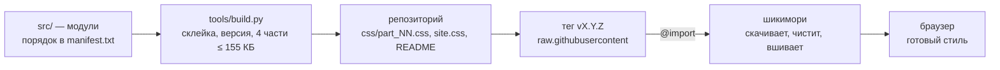

# shiki glass — архитектура проекта

> подробная карта темы для [шикимори](https://shikimori.one), актуально для **v1.7**: где что лежит, как шикимори загружает и чистит css, как устроена палитра, как выходят релизы и чем отличаются телефон и пк.

## содержание

- [коротко](#коротко)
- [репозиторий: файлы и папки](#репозиторий-файлы-и-папки)
- [модули src/](#модули-src)
- [сборка и проверки](#сборка-и-проверки)
- [почему тема разбита на части (v1.2.23)](#почему-тема-разбита-на-части-v1223)
- [палитра](#палитра)
- [как считаются оттенки](#как-считаются-оттенки)
- [как шикимори загружает и фильтрует css](#как-шикимори-загружает-и-фильтрует-css)
- [site.css: установка и настройка](#sitecss-установка-и-настройка)
- [выпуск релиза](#выпуск-релиза)
- [телефон и пк](#телефон-и-пк)
- [заметные фичи](#заметные-фичи)
- [известные ограничения](#известные-ограничения)
- [история версий](#история-версий)

краткая памятка для правок — в [AGENTS.md](../AGENTS.md). инструкция для обычных пользователей — в [README](../README.md): без пределов импорта, размеров частей, сборки и устройства `site.css` (всё это описано ниже).

## коротко

| | |
|---|---|
| **репозиторий** | github.com/Hikisey/shikimori-theme |
| **текущая версия** | см. подвал сайта «shiki glass vX.Y.Z» и последний тег; 4 части по ≤ 155 КБ |
| **основа** | тема E-design от ed-main, переписанная и расширенная |
| **объём** | 39 модулей в `src/` (~620 КБ с комментариями); сборка вырезает комментарии, выпускается 4 частями `css/part_NN.css` по ≤ 155 КБ (~560 КБ, запас ~58 КБ на v1.7.0) |
| **подключение** | по строке `@import` на каждую часть (с тегом версии) + блок палитры в «Внешнем виде сайта» |
| **без js** | всё сделано на чистом css: шикимори не пускает скрипты в стили |



## репозиторий: файлы и папки

| путь | зачем |
|---|---|
| `src/` | исходники: 39 модулей по слоям (таблица ниже) и `manifest.txt` с порядком каскада |
| `css/part_NN.css` | то, что подключается: модули подряд, нарезанные между правилами на 4 части ≤ 155 КБ. руками не правятся |
| `tools/build.py` | сборка `src/` → `css/`, подстановка версии в подвал, печать строк `@import` |
| `tools/quick_check.py`, `tools/shot.js` | быстрая проверка: сборка во временную папку, эмуляция фильтра, жёсткие правила, скриншот сохранённой страницы |
| `tools/shiki_compile.py` | эмуляция фильтра шикимори (SanitizeEvilCss + camo): что останется от css после загрузки |
| `tools/shiki_url_check.py` | проверка, что после camo ни одна ссылка не «съела» соседний код |
| `site.css` | готовый стиль для вставки: ровно 4 импорта — части темы с тегом (тёмный CodeMirror с v1.7.16 внутри темы, `vendor/codemirror-dark.css`), палитра с комментариями, дополнительные блоки |
| `themes/<тема>/` | готовые темы (с v1.7.19; с v1.7.21 — «лунная ночь» по умолчанию, «алая» (прежняя основная), «неоновый квартал», «туманные тории», «туманное озеро», «фиолетовое небо»): `site.css` (собирает `tools/build_themes.py`: полная палитра `BASE` + отличия темы; палитру темы `DEFAULT` он же пишет в корневой `site.css` и обновляет раздел «Готовые темы» в README между `<!-- themes:start -->` и `<!-- themes:end -->`), обои `bg.webp` и `bg_m.webp`, баннер `banner.webp`, скриншот `preview.webp` — компьютер (профиль hikisey) и телефон (главная) одной картинкой одной высоты (`tools/preview_pair.py`) |
| `README.md` | только для пользователей: короткая установка, цвета, скриншоты, простые вопросы; технические пределы импорта, сборка и `site.css` — в этом документе |
| `bg.webp`, `bg_m.webp` | обои прежней алой темы по умолчанию (копия — `themes/crimson/`); остаются в корне: у старых стилей ссылка `//cdn.jsdelivr.net/gh/Hikisey/shikimori-theme/bg.webp` без версии |
| `bg_blue.webp`, `bg_blue_m.webp`, `bg_purple*.webp`, `banner_purple.webp` | старые обои: пример «Синяя ночь» (из README убран в v1.7.21) и фиолетовая копия (теперь `themes/purple/`); остаются для стилей, где они подключены по ссылке без версии |
| `docs/preview.webp`, `docs/home.jpg`, `docs/catalog.jpg`, `docs/profile.jpg` | скриншоты для README в теме по умолчанию («лунная ночь»): `preview.webp` — страница аниме на компьютере и телефоне одной картинкой (`tools/preview_pair.py`) |
| `docs/ARCHITECTURE.md` | этот документ |
| `AGENTS.md` | короткая навигация и жёсткие правила для правок (для ai-ассистентов и людей) |

## модули src/

слои идут в таком порядке: токены → база → каркас → компоненты → страницы → наборы «О себе» → подвал → поздние правила. внутри слоя порядок модулей подобран так, чтобы как можно меньше правил пришлось оставлять в `overrides/late.css`.

| модуль (в порядке каскада) | строк | КБ | что внутри |
|---|---|---|---|
| `tokens/palette.css` | 219 | 17.0 | палитра: акцент, фон, стекло, текст и производные оттенки (переопределяется блоком «Палитра» в site.css) |
| `tokens/components.css` | 87 | 4.9 | токены компонентов: --plate-*, --heading-*, --btn-*, --chip-*, --tool-*, --arrow-*, --card-*, --tip-*, --tab-*, --field-*, --ease-* (см. «токены компонентов») |
| `base/fonts.css` | 142 | 6.1 | @font-face: шрифты и иконочный шрифт |
| `base/base.css` | 627 | 15.6 | база: ссылки, текст, таблицы, полосы прокрутки, служебные мелочи |
| `base/animations.css` | 294 | 5.4 | все @keyframes темы |
| `base/colors.css` | 46 | 1.2 | цветовые классы bb-кодов и подсветки (.red, .green, …) |
| `layout/header.css` | 568 | 27.4 | верхняя панель .l-top_menu-v2, выпадающие меню, глобальный поиск |
| `layout/page.css` | 1077 | 35.5 | каркас страницы: html/body, обои, .l-page, колонки и сетки .cc/.c-column |
| `components/badges.css` | 150 | 4.8 | статусы и метки: *_status_tag, *_marker, .b-tag |
| `components/carousels.css` | 212 | 7.2 | ленты, стрелки, пагинация, кнопка «наверх»; стрелки лент (::scroll-button) |
| `components/tooltips.css` | 182 | 4.7 | подсказки .tipsy, .b-tooltipped, всплывающие карточки |
| `components/headings.css` | 299 | 7.3 | заголовки .headline / .subheadline / .midheadline |
| `components/users.css` | 161 | 4.1 | пользователи и аватары: .b-user, .b-user16, .b-menu-line |
| `components/buttons.css` | 313 | 10.3 | кнопки .b-link_button, .b-button, button, кнопки действий |
| `components/stats.css` | 72 | 2.9 | полоски-шкалы .bar |
| `components/tabs.css` | 603 | 15.1 | вкладки и переключатели: .b-options-floated, .b-list_switchers, use-tabs |
| `components/plates.css` | 18 | 0.4 | стеклянные плашки .block |
| `components/cards.css` | 354 | 10.3 | карточки аниме/манги .b-catalog_entry, обложки .image-decor |
| `components/editor.css` | 1014 | 26.6 | комментарии, редактор .b-shiki_editor, спойлеры, цитаты, код |
| `components/modals.css` | 59 | 1.4 | окна: просмотр картинок (mfp), bulma-модалки, обратная связь |
| `components/forms.css` | 538 | 15.9 | поля, select и мультиселект фильтров (.c-ms), галочки, @starting-style выезда списков |
| `components/motion.css` | 72 | 3.9 | лёгкие анимации (v1.7.10): пружинное нажатие кнопок, появление комментариев и окон; только scale/translate/opacity, при «уменьшении движения» выключены |
| `pages/clubs.css` | 255 | 6.7 | клубы |
| `pages/profile.css` | 1941 | 63.4 | профиль: шапка, баннер, история, списки-статистика, совместимость, друзья |
| `pages/anime.css` | 1109 | 36.0 | страница аниме/манги/персонажа: описание, постер, кадры и видео, плеер, «добавить в список» |
| `pages/settings.css` | 280 | 9.0 | настройки профиля и аккаунта, сервисы входа |
| `pages/catalog.css` | 704 | 30.7 | каталог: фильтры слева, коллекции, поиск |
| `pages/messages.css` | 580 | 15.1 | почта, диалоги, уведомления |
| `pages/lists.css` | 653 | 22.9 | списки аниме/манги пользователя, сравнение списков |
| `pages/achievements.css` | 1271 | 38.7 | ачивки: страница и блок в профиле |
| `pages/contests.css` | 152 | 3.9 | турниры |
| `pages/forum.css` | 928 | 28.3 | форум, топики, отзывы и рецензии, опросы |
| `pages/dashboard.css` | 368 | 11.0 | главная: новости, темы дня, «мой список» |
| `kits/custom-posters.css` | 80 | 2.8 | свои постеры персонажей и точечные правки отдельных профилей |
| `kits/about-kits.css` | 1438 | 34.6 | наборы для «О себе»: Animes_Mangas, Ssylki, Razmer, k-0-1 и т. п. (не удалять) |
| `layout/footer.css` | 70 | 1.4 | подвал и подпись «shiki glass vX.Y.Z» |
| `overrides/late.css` | 3776 | 124.1 | правила, которые обязаны идти после всех модулей (см. ниже и шапку файла) |
| `vendor/codemirror-dark.css` | 92 | 4.0 | тёмный редактор кода (CodeMirror «material», MIT, Mattia Astorino; версия css-club), без изменений; последним — на месте бывшего 5-го `@import` |
| `overrides/codemirror-tint.css` | 36 | 1.9 | рамка редактора кода в цвет темы (v1.7.19): фон из `--glass` с 10% акцента, номера строк `--text-3`, выделение и курсор из акцента; подсветка синтаксиса — как в vendor-файле |
| **всего** | **20840** | **662.6** | |

**телефон рядом с модулем.** в конце каждого модуля — раздел `/* ----- телефон и узкие экраны ----- */`: его правила для ширины ≤1023 и сенсорных экранов (`hover: none`, `pointer: coarse`). несколько телефонных правил остались в основной части модуля внутри своего `@media` — их нельзя опустить ниже соседей.

**`overrides/late.css`.** около 480 правил (365 блоков), которые обязаны идти после модулей: они перебивают правило более позднего модуля с той же специфичностью и важностью, касаются всего сайта (блок «Уменьшение движения» в конце) или пересекаются с правилами многих модулей (метки `body * [class*="_marker"]`, цвета-классы, правила только для shikimori.rip). в v1.7.4–v1.7.9 из него вынесено 82 блока (~16 КБ), в v1.7.14 — ещё 26 (~3.8 КБ: статусы, тултипы, карточки, сообщения, дашборд, профиль, списки, ачивки, аниме, шапка, настройки, кнопки, форум, «О себе», заголовки, .b-user16) — только те, у которых доказано, что после переноса результат никто не перебьёт: статическая проверка каскада (`move.py`) + сверка вычисленных стилей на затронутых страницах корпуса (452 страницы, из них 34 под логином) × 10 режимов (`cdiff2.js`), инструменты и описание в `tools/regress/late/`. остальное подписано в самом файле (`labels.py`, только комментарии — сборка от них не меняется): у 57 блоков (~32 КБ, «дом X · перебивает Y») есть элементы, на которых и правило, и перебиваемое им правило реально совпадают; у ~283 блоков (~66 КБ, «дом X · без доказательства») пересечение по корпусу нельзя ни доказать, ни опровергнуть (в том числе 10 блоков, которые не находят ни одного элемента на сохранённых страницах); остальное — общие правила и правила только для shikimori.rip. новое правило кладите в свой модуль; в `late.css` — только по причинам из шапки файла.

**токены компонентов (`tokens/components.css`, шаг 2 рефакторинга).** одинаковые элементы берут значения из общих переменных на `:root`, поэтому вид плашек, заголовков, кнопок, стрелок, карточек и плавность наведения меняются в одном месте (или в site.css внутри `html:root { … }`). заменялись только значения, в точности равные токену, поэтому вычисленные стили не изменились (проверено на всех сохранённых страницах).

| группа | токены | где используются |
|---|---|---|
| плашки | `--plate-bg`, `--plate-bg-strong`, `--plate-shadow`, `--plate-shadow-soft`, `--plate-shadow-strong`, `--plate-blur`, `--plate-radius`, `--plate-radius-lg` | 191 объявление во всех модулях: стеклянный фон, тень, скругление 10/14px, `backdrop-filter` |
| заголовки | `--heading-radius`, `--heading-height`, `--heading-text`, `--heading-link`, `--heading-dot`, `--heading-dot-hover` | .headline / .midheadline / .subheadline |
| кнопки | `--btn-bg`, `--btn-bg-hover`, `--btn-text` | .b-link_button, .b-button и кнопки того же цвета |
| метки формы комментария | `--chip-bg`, `--chip-border`, `--chip-text`, `--chip-on-text`, `--chip-radius`, `--chip-tint` | «Оффтоп», «18+», «На shiki» и кнопки панели выбора в `components/editor.css`; включённые окрашены акцентом |
| значки редактора | `--tool-icon`, `--tool-icon-off` | панель кнопок редактора комментария |
| стрелки лент | `--arrow-size`, `--arrow-bg`, `--arrow-bg-hover`, `--arrow-border`, `--arrow-shadow`, `--arrow-icon-size`, `--arrow-inset` | `::scroll-button` лент, общий блок в `components/carousels.css`; каждая лента отдельным селектором (rip не принимает `:is(...)::scroll-button`) |
| карточки | `--card-radius`, `--card-image-radius`, `--card-lift`, `--card-hover-shadow`, `--card-zoom` | .b-catalog_entry |
| подсказки | `--tip-bg`, `--tip-radius`, `--tip-shadow` | .tipsy |
| вкладки | `--tab-active`, `--tab-tap-ease` | components/tabs, анимация нажатия переключателей |
| поля | `--field-text`, `--drop-shift` | components/forms: текст полей, сдвиг выпадающих списков |
| плавность | `--ease-out`, `--ease-fast`, `--ease-base` | `transition`/`animation`, в том числе внутри списков `transition` (`background-color var(--ease-fast), …`) |

в `-webkit-backdrop-filter` токены не используются: там всегда фиксированное значение (у Safari баг с переменными).

**очистка (v1.2.24).** удалялось только то, что точно не работает на нынешнем сайте или ни на что не влияет:
- правила для классов, которых нет ни на сохранённых страницах, ни в css и скриптах шикимори, ни в его старом исходном коде, и которые относятся к убранным разделам: старый видеоплеер (`.b-video_variant`, `.b-video_player`, `.cc-player_controls`, `.c-anime_video_episodes`…), виджет VK (`.wcommunity_*`), старое верхнее меню `.l-top_menu` — 87 правил и 12 селекторов из списков. классы, которые просто не встретились (наборы «О себе», `use-tabs`, `custom-panel`, Vue-компоненты, окна), не удалялись;
- объявления, которые всегда перебивает более позднее правило с теми же селекторами и не более узкими медиазапросами (с учётом сокращений вроде `background`/`margin` и `!important`; запасные значения для старых браузеров не трогались) — 35, из них 4 правила целиком;
- повторы селектора внутри одного списка — 25;
- `!important`, если это свойство больше нигде не задаётся ни темой, ни шикимори для тех же элементов, — 1. остальные `!important` перебивают стили шикимори или встроенные стили из скриптов, доказать их ненужность нельзя.

### как модули получены из v1.2.23 (без изменений внешнего вида)

1. весь каскад v1.2.23 (файлы 1 → 2 → 3 → 4mob) разобран на 2 793 элемента: правила, `@font-face`, `@keyframes`, `@starting-style`; вложенные `@media`/`@supports` сохранены как обёртки каждого правила.
2. каждому правилу назначен модуль по селектору: сначала наборы и страницы, затем каркас и компоненты, остальное — `base`.
3. для каждой пары правил, где порядок важен, записано ограничение «A раньше B». порядок важен, если у правил есть общее свойство (с учётом сокращений вроде `margin` и `margin-top`), одинаковая важность (`!important`), равный вес селектора, совместимые медиазапросы и один и тот же псевдоэлемент. и ещё одно условие: селекторы могут попасть в один элемент. это проверялось по 79 209 элементам 36 сохранённых страниц, а для селекторов, которых на этих страницах нет, — по общему классу, тегу или атрибуту в правой части селектора. получилось 3 326 ограничений.
4. если модуль правила стоит в манифесте раньше, чем того, после которого правило обязано идти, оно уходит в `overrides/late.css`; телефонное правило в такой ситуации остаётся в основной части модуля.
5. проверка: вычисленные стили всех элементов (а также `::before` и `::after`) на 30 страницах пк (1280) и 15 телефонных (390): обычное состояние и состояние наведения, фокуса и нажатия (`:hover`/`:focus`/`:active` подменялись классами на всех элементах). плюс ширины 820 и 1100 на 11 страницах. результат — 0 отличий от v1.2.23. после фильтра шикимори все части парсятся без ошибок.

## сборка и проверки

- **сборка:** `python3 tools/build.py [--version X.Y.Z]` — склейка модулей по `src/manifest.txt`, нарезка между правилами по `css/part_NN.css` (≤ 155 000 байт, жёсткий предел 160 КБ и 4 части), версия в `layout/footer.css`, в конце строки `@import`. модуль, которого нет в манифесте, в сборку не попадёт — скрипт предупредит.
- **быстрая проверка (по умолчанию для мелких правок):** `python3 tools/quick_check.py --page <сохранённая страница> [--phone]` — сборка во временную папку, эмуляция фильтра шикимори с проверкой, что не пропало ни одно правило, проверка ссылок после camo, жёсткие правила (behavior, `@view-transition`, обратные слэши, размер частей), счётчик `:hover` вне медиазапроса, скриншот страницы с темой и палитрой из `site.css`.
- **сборка без комментариев:** `build.py` убирает комментарии из `css/part_NN.css` (в `src/` они остаются). Шикимори и так вырезает их при загрузке, а размер файла считается с ними; без них в 4 части помещается на ~56 КБ больше. В начале каждой части — метка `html:root { --sg-pN: ""; }`; блок в `site.css` показывает в левом нижнем углу надпись «не загрузилась часть N», если метки нет.
- **проверки quick_check (с v1.7.0):** вложенный `:has()`, псевдоэлемент внутри `:is()`/`:where()`, неизвестный id страницы (`tools/page_ids.txt`), `backdrop-filter` без пары `-webkit-` и `-webkit-backdrop-filter` с `var()`, повтор `@keyframes`, рост числа `:hover` вне медиазапроса (`HOVER_MAX`), запас размера.
- **полная регрессия (перед релизом):** `tools/regress/` —
  - `mkstyle.py <папка частей> <site.css> <out.css>` — стиль, каким его отдаёт Шикимори (фильтр + палитра);
  - `cdiff.js A.css B.css out.json страницы…` — вычисленные стили всех элементов и `::before`/`::after` (Chromium, ширины из `WIDTHS`, по умолчанию 1366 и 390, переходы и анимации выключены) — должно быть 0 отличий для правок без изменения вида;
  - `shots.js style.css папка chromium|webkit pc|phone страницы…` + `imgdiff.py A B diff` — скриншоты (WebKit = движок Safari) и доля изменившихся пикселей; сеть кешируется (`NETCACHE`), шум ~0,02 %;
  - `coverage.js style.css out.json страницы…` — какие селекторы не совпали ни на одной сохранённой странице.

## палитра

все цвета темы пишутся rgb-тройкой «R, G, B», поэтому работает `rgba(var(--x), .5)`. старые имена из прошлых версий понимаются как запасные.

| переменная | по умолчанию | что перекрашивает |
|---|---|---|
| `--accent` | 232, 108, 108 | ссылки, значки, подсветка, активные вкладки, полоски; из него — кнопки, ник, наведение |
| `--link` | = accent | только ссылки |
| `--bg-image` / `-mobile` | обои темы | обои пк и телефона |
| `--bg-color` / `-mobile` | 28,30,33 / 167,148,145 (в site.css: 151,128,128 / 167,148,145) | цвет под обоями, пока они грузятся |
| `--bg-zoom` | 1.08 | приближение обоев на пк |
| `--bg-blur` / `-mobile` | 0px / 1.5px | размытие обоев |
| `--bg-dim` | .5 | затемнение обоев (`body:after`) |
| `--bg-brightness-mobile` | .9 | яркость обоев на телефоне |
| `--profile-banner*` | none, 300px, 170px, center, .5 | баннер профиля: картинка, высота пк/телефон, позиция, свечение |
| `--glass` | 30, 34, 42 | стекло блоков; из него — панель, меню, окна, тени |
| `--glass-light` | 255, 255, 255 | рамки и блики на стекле |
| `--glass-blur` | 5px | размытие под стеклом (Chrome, Firefox) |
| `--text` | 236, 240, 247 | основной текст |
| `--text-2` | 170, 178, 192 | подписи, второстепенный текст; из него — текст полей |
| `--text-3` | 140, 148, 160 | даты, счётчики |
| `--text-strong` | 255, 255, 255 | заголовки карточек, текст на кнопках |
| оценки и шкалы | отдельная группа | `--*-rating`, `--time-filled/empty`, `--anime-*`, `--manga-*` |

около 470 цветов намеренно оставлены числами: статусы списков и меток, золотая страница ачивок, цвета bb-кодов, подсветка кода, бренды vk, ники отдельных людей, радуги и цвета наборов «О себе», маски.

## как считаются оттенки

каждый производный оттенок задан дважды: сначала числом (старые браузеры), потом формулой относительного цвета, которая при значениях по умолчанию даёт ровно то же число.

```css
--accent-dim: rgb(178, 58, 64);   /* запасное значение */
@supports (color: rgb(from red r g b)) {
  html:root {
    --accent-dim: rgb(from rgb(var(--accent)) calc(r * 178 / 232) calc(g * 58 / 108) calc(b * 64 / 108));
  }
}
/* прозрачность — через color-mix */
background: color-mix(in srgb, var(--glass-deep) 55%, transparent);
```

| оттенок | из чего | где |
|---|---|---|
| `--accent-dim` | accent | кнопки, подложка ника |
| `--accent-hover` | accent | кнопки под курсором |
| `--link-hover` | link (к белому) | ссылки под курсором |
| `--glass-deep` | glass | меню, затемнение обоев, стеклянные плашки телефона |
| `--glass-bar` / `-bar-hover` | glass | верхняя панель |
| `--glass-popup` | glass | выпадающие списки, подсказки |
| `--glass-active` | glass | нажатые и выбранные элементы |
| `--glass-shadow` | glass | тени |
| `--text-input` | text-2 | текст в полях |
| `--tone-xxxxxx` (59 шт.) | glass / text / accent | серые и светлые служебные цвета |

перед выпуском v1.2.20 все 1 260 изменённых деклараций сравнивались по вычисленным значениям в Chrome и WebKit, скриншоты при значениях по умолчанию совпали попиксельно (кроме номера версии).

## как шикимори загружает и фильтрует css

1. **вырезает @import** — из «Внешнего вида сайта» достаются все `@import url(...)`, остальное — пользовательский css
2. **скачивает на своём сервере** — каждый адрес качается сервером шикимори (до 2 попыток, таймаут около 5 с), браузер github не видит
3. **кеширует на 8 часов** — ключ кеша — точный адрес; пустой ответ после неудачи тоже может пролежать в кеше 8 часов
4. **чистит (SanitizeEvilCss)** — удаляет комментарии, опасные слова, обратные слэши и лишние data:-картинки
5. **переписывает ссылки (camo)** — картинки идут через прокси шикимори
6. **склеивает** — импорты вшиваются первыми; css без `@media` оборачивается в `@media only screen and (min-width: 1024px)`

| ловушка | что происходит | как обходим |
|---|---|---|
| слово behavior | удаляется везде (`scroll-behavior` → `scroll-`) | плавной прокрутки нет; слово не используем |
| обратный слэш | `\` + буква/цифра удаляется вне строк `content:` | никаких экранирований, кроме иконок в `content` |
| camo и `;` | регулярка ссылки «съедает» `)` и `}` после `url(...)`, если нет `;` | всегда `url(...);` перед `}`, без минификации |
| символ `@` в ссылке | вырезается | ссылки на картинки без `@` |
| data:-uri | остаются только base64 `image/svg+xml\|png\|jpeg\|jpg\|gif` | галочка, play и т. п. — base64 svg |
| `@media`-обёртка | css без `@media` уходит только на ширину ≥1024 | палитра всегда в `@media (min-width: 1px)` |
| другие слова | eval, cookie, window, parent, this, script, expression… | не встречаются в коде и комментариях |

> **ℹ️ ссылки с `//` тоже идут через прокси.** по исходникам шикимори (`Styles::Compile#camo_images` → `generate_camo_url`) регулярка находит в css и `https://…`, и `//…`. ссылке с `//` добавляется протокол, после чего она так же переписывается на camo-прокси шикимори. мимо прокси проходят только адреса доменов самого шикимори (они отдаются без протокола); адреса из списка запрещённых доменов заменяются прозрачной картинкой. в старом коде шикимори прямые ссылки на `//` и `https://` действительно пропускались без прокси, но этот код закомментирован: «прямые ссылки раскрывают ip пользователей». значит, `//` в ссылках на обои ничего не меняет — работает так же, как `https://`.

## site.css: установка и настройка

1. **открыть site.css нужного тега** — raw.githubusercontent.com/Hikisey/shikimori-theme/vX.Y.Z/site.css
2. **скопировать целиком** — ровно 4 импорта — части темы (все с raw.githubusercontent); сторонних импортов нет: свои постеры с v1.7.12, тёмный CodeMirror с v1.7.16 внутри темы
3. **вставить в «Внешний вид сайта»** — заменить всё старое, сохранить, обновить страницу с Ctrl+Shift+R
4. **менять только блок «Палитра»** — `@media screen and (min-width: 1px) { html:root { … } }`, обёртку не удалять

```css
@import url("https://raw.githubusercontent.com/Hikisey/shikimori-theme/vX.Y.Z/css/part_01.css");
@import url("https://raw.githubusercontent.com/Hikisey/shikimori-theme/vX.Y.Z/css/part_02.css");
@import url("https://raw.githubusercontent.com/Hikisey/shikimori-theme/vX.Y.Z/css/part_03.css");
@import url("https://raw.githubusercontent.com/Hikisey/shikimori-theme/vX.Y.Z/css/part_04.css");
```

`html:root` в палитре нужен, чтобы вес селектора совпал с палитрой темы и пользовательский блок, идущий позже, побеждал.

## выпуск релиза

1. **правка исходников** — модули `src/`, никогда сами файлы в `css/`
2. **сборка** — `python3 tools/build.py --version X.Y.Z` — версия попадает в `--theme-version` и в подвал, `css/` пересобирается 4 частями ≤ 155 КБ (build.py остановится, если частей больше 4 или часть больше 160 КБ)
3. **проверки** — `tools/quick_check.py` без ошибок (фильтр шикимори, ссылки, behavior, `@view-transition`, размеры) и полная регрессия
4. **скриншоты до/после** — пк 1280 в Chrome, iPhone 13 в WebKit и телефон в Chrome
5. **версия в site.css и README** — замена старого тега на новый
6. **commit, push, тег, GitHub release** — релиз с описанием на русском
7. **проверка raw-адресов** — все части отдают 200 и побайтно совпадают с репозиторием; если число частей изменилось, обновить строки в `site.css` и README

- теги, а не main: шикимори кеширует каждый адрес на 8 часов, а новый тег — новый адрес, который скачается сразу и не изменится потом
- main только для разработки; в v1.2 пробовали следить за main и сбрасывать кеш `?v=2`, `?v=3` — от этого отказались
- без минификации: в v1.2.9 сжатие склеило `url("…")}`, camo съел скобку и следующие правила пропали; v1.2.10 вернул читаемый вид
- у тега v1.2.4 нет GitHub-релиза; опубликованные теги не переносятся

## пределы импорта шикимори (v1.3.5)

| предел | откуда известно |
|---|---|
| **на shikimori.io — только 4 первых `@import`** (v1.7.11: в стиле профиля на .io подключились 2 строки css-club и части 1–2, части 3–4 пропали без ошибки; rip принимает все, предпросмотр с 7 импортами по ~85 КБ прошёл). поэтому в `site.css` 4 части темы стоят первыми; с v1.7.16 других импортов нет (CodeMirror_dark пятым импортом на .io давал «не удалось импортировать» — встроен). раньше предел был ~6 | v1.3.3: части 5–8 из 8 с raw.githubusercontent «не удалось импортировать», 1–4 подключились; v1.3.4: те же 5–8 с jsDelivr — снова ошибка. дело не в хосте, а в номере импорта |
| **файл не больше ~230 КБ** | v1.2.20: 4 файла, самый большой 225 КБ — подключались; v1.2.21: файл 231 КБ — нет (таблица ниже) |

- **решение (v1.3.5).** тема собирается ровно в 4 части ≤ 155 КБ (запас до ~230 КБ). `tools/build.py` раскладывает модули целиком в порядке манифеста и останавливает сборку, если часть больше 160 КБ или частей больше 4. все части — с raw.githubusercontent с тегом.
- **история ошибки.** в v1.2.23–v1.3.4 тема шла 7–8 частями по ≤ 80 КБ. пока частей было 7, ошибки не замечали (импорты 7–9 тоже могли не грузиться — неполная тема выглядела почти нормально); в v1.3.4 подумали на ограничение GitHub и перенесли 5–8 на jsDelivr — не помогло.
- если понадобится больше css, чем 4 × 150 КБ, сначала поднимать предел части (до ~200 КБ, проверив импорт), а не число частей.

## почему тема разбита на части (v1.2.23)

на v1.2.21–v1.2.22 шикимори писал «Не удалось импортировать» про `main_code_4mob.css`, а остальные три файла (около 100 КБ каждый) подключались.

| версия | размер 4mob | результат |
|---|---|---|
| v1.2.20 | 225 317 Б | подключался |
| v1.2.21 | 231 438 Б | не подключился |
| v1.2.22 | 233 749 Б | не подключился |

- **что известно.** в старом коде шикимори (Rails) файл качается сервером: таймаут ответа 5 с, соединения 2 с, ответ кроме «200 + UTF-8» превращается в пустую строку и кешируется на 8 часов; пустой импорт и есть «не удалось импортировать». сам файл валиден: UTF-8, парсится, эмуляция фильтра ничего лишнего не вырезает. сайт сейчас работает на новом фронтенде, и точные лимиты нового загрузчика снаружи не видны.
- **вывод.** отказ совпал с ростом файла за отметку около 225–231 КБ, а файлы около 100 КБ грузятся стабильно. скорее всего, у загрузчика есть предел размера ответа или времени загрузки, и большой файл в него не укладывается. содержимое тут ни при чём: те же правила, нарезанные на части, после фильтра дают байт-в-байт тот же css.
- **решение тогда (v1.2.23).** правила резались на части не больше 80 КБ; с v1.3.5 — 4 части ≤ 155 КБ, см. «пределы импорта шикимори» выше.
- **почему не jsDelivr.** по старому коду адрес `cdn.jsdelivr.net/gh/Hikisey/shikimori-theme@v1.2.23/css/…` допустим (`@` в адресе импорта не вырезается, обои с jsDelivr уже идут через camo). но ограничения нового загрузчика по хостам проверить снаружи нельзя, а raw.githubusercontent с тегом проверен на всех прошлых версиях. поэтому основной путь — raw, а jsDelivr — запасной: те же пути, `@vX.Y.Z` вместо `/vX.Y.Z`. на jsDelivr ограничения размера не помогли бы — если дело в размере, большой файл не пройдёт и оттуда.
- **после выпуска** все адреса открываются один раз (прогрев кеша GitHub). если неудача уже закешировалась у шикимори, адрес из сообщения сбрасывается на `shikimori.io/tests/reset_styles_cache`.

## телефон и пк

| что | как |
|---|---|
| брейкпоинты | пк ≥1024 (баннер и ачивки ≥1200), планшет 768–1023, телефон ≤767, мелкие экраны 650/540/480/420/350 |
| правки только для телефона | только внутри `@media screen and (max-width: 767px)` |
| наведение | любой `:hover` только в `@media (hover: hover) and (pointer: fine)`, на сенсорах — короткий отклик нажатия |
| списки | на сенсорных экранах select — системный (колёсико iOS); на пк — общий компонент поля с анимацией |
| стекло | на телефоне плашки с `backdrop-filter`; для Safari сила размытия записана числом. С v1.7.2 у повторяющихся блоков нет своего размытия: комментарии лежат на одном общем размытом слое `.b-comments`, размытие внутри размытия убрано (`pages/forum.css`, блок «Телефон: размытие под стеклом только там, где оно видно»). Новые повторяющиеся карточки так же: общий слой у контейнера, у карточки только заливка |
| обои | отдельный лёгкий кадр `bg_m.webp`, лёгкое размытие 1.5px и яркость .9 |
| фильтры | карточка по центру экрана, плотное матовое стекло, списки раскрываются через grid-rows 0fr↔1fr |

## заметные фичи

| фича | версия | как сделано |
|---|---|---|
| ленты кадров и видео | v1.2.16–17 | горизонтальная прокрутка со scroll-snap, 16:9, play-кнопка из base64 svg, заголовок и лента — одна стеклянная панель |
| стрелки лент | v1.2.17 | `::scroll-button(*)` (Chromium 135+), только пк с мышью, под `@supports selector(...)` |
| логотипы студий | v1.2.18–19 | скругление, контур 1px через drop-shadow; чёрные прозрачные логотипы (id 11, 44, 858) — белым силуэтом; подъём на 3px |
| иконки сайтов | v1.2.18 | светлый круглый бейдж 20px под favicon в «На других сайтах» |
| галочки | v1.2.13–15 | круг 18px по середине строчных букв, svg-галочка растёт и сжимается |
| фильтры | v1.2–1.2.21 | общий компонент полей, плавное раскрытие, карточка на телефоне |
| баннер профиля | v1.0, v1.2.21 | пк: 300px над шапкой со свечением; телефон: 170px сверху, аватар на нижнем крае |
| палитра | v1.2.20 | все цвета на переменных, 4 группы |

## известные ограничения

- нет плавной прокрутки по стрелкам: шикимори вырезает слово behavior, обход через экранирование тоже вырезается
- в режиме списка у шикимори в разметке нет постеров, css их не добавит
- Safari: `-webkit-backdrop-filter` не понимает `var()`, поэтому `--glass-blur` действует только в Chrome и Firefox
- до Chrome 119 и Safari 16.4 производные оттенки не пересчитываются, остаются цветами по умолчанию
- режим блокировки iPhone (Lockdown Mode) не отключает backdrop-filter, но блокирует часть веб-шрифтов и экспериментальные функции
- стрелки `::scroll-button` есть только в Chromium 135+, в остальных браузерах лента листается свайпом и колесом
- старые имена палитры для оттенков (`--buttoms-color`, `--menu-back`, `--popup-color`…) больше не задаются отдельно

## история версий

| версия | что изменилось |
|---|---|
| v1.0–v1.1 | своя тема на основе ed-main: обои, баннер, общий компонент полей, анимации списков, яркие иконки сервисов |
| v1.2 | облегчение кода, фиксы select, телефон: размытые обои, карточка фильтров, плитки действий |
| v1.2.1 | жидкое стекло фильтров, поля 16px, профиль карточками |
| v1.2.2 | строка «Время за аниме» над шкалой |
| v1.2.3 | читаемость на телефоне: тень текста, стекло под заголовками и блоками |
| v1.2.4 | обои снова с лёгким размытием 1.5px |
| v1.2.5 | мягче стекло на телефоне |
| v1.2.6 | плавное сворачивание списков фильтра |
| v1.2.7 | iPhone: системный select, без клавиатуры в коротких списках |
| v1.2.8 | hover только для мыши, отклик нажатия на сенсорах |
| v1.2.9 | сжатие 4mob — сломало правила после url (camo) |
| v1.2.10 | возврат к читаемому виду |
| v1.2.11–12 | список аниме на пк: стеклянные заголовки и поиск |
| v1.2.13–15 | галочки по тексту, подпись темы в подвале, svg-галочка по центру |
| v1.2.16 | кадры и видео лентами сразу после описания |
| v1.2.17 | стрелки лент, одна стеклянная панель, логотипы студий |
| v1.2.18 | адаптивные логотипы, бейджи иконок сайтов |
| v1.2.19 | чёткие логотипы, подъём на 3px вместо алого свечения |
| v1.2.20 | все цвета на переменных: акцент, фон, стекло, текст |
| v1.2.21 | стекло на iPhone снова размыто, баннер на телефоне, плотная панель фильтров, кнопка-крестик на экране |
| v1.2.23 | тема подключается 7 частями по ≤ 80 КБ вместо 4 файлов (4mob на 234 КБ перестал импортироваться); короткий README. после релиза в `main`: исходники разбиты на 35 модулей, `tools/build.py`, `tools/quick_check.py` |
| v1.2.24 | внутренняя переделка без изменений внешнего вида: исходники в 36 модулях, общие токены компонентов (`tokens/components.css`: плашки, заголовки, кнопки, стрелки лент, карточки, подсказки, вкладки, поля, плавность), 60 поздних правил вернулись домой, удалены правила старого видеоплеера, виджета VK и старого меню, перебитые объявления и повторы селекторов; 8 частей |
| v1.3.0 | тот же код, что v1.2.24, выпущен как 1.3.0: перестройка кода — модули, общие компоненты и токены; внешне без изменений |
| v1.3.1 | телефон, фильтры каталога: шторка и затемнение плавно появляются и исчезают (`@starting-style` + `allow-discrete`, токены `--sheet-time`/`--sheet-shift`); списки фильтров раскрываются плавно и без «пружины» при касании; в списках с поиском строка поиска внизу, варианты над ней — не уходят под клавиатуру (`--drop-max`, `--drop-max-typing`) |
| v1.3.2 | фильтры каталога: списки в панели (ПК и телефон) раскрываются и сворачиваются одним механизмом — строки сетки `0fr ↔ 1fr` + прозрачность, анимация в обе стороны; списки раздвигают поля ниже и больше не наслаиваются; у выпадающих списков вне панели вернулась анимация открытия (`@starting-style` с двойным классом); телефон: поиск снова сверху, при вводе поле поднимается под заголовок «Фильтры» (scroll-snap + `scroll-margin`, токены `--sheet-head`, `--sheet-typing-room`), варианты под ним уходят под клавиатуру и листаются (`--drop-max-typing`, `--drop-time`) |
| v1.3.3 | списки фильтров (ПК и телефон) опускаются вниз так же, как «Сортировка»: общие токены `--drop-time`/`--drop-ease` = `--ui-drop`/`--ui-ease`, строки сетки `min-content 0fr ↔ 1fr` (поле больше не «подпрыгивает») + сдвиг `--drop-shift`, без прозрачности и перелёта; шторка фильтров и затемнение на телефоне появляются через `@keyframes` (`shiki-sheet`, `shiki-fade`, fill `backwards`) — работает в любом Safari, закрытие — transition с `allow-discrete`; на сенсорных экранах текст не выделяется (кроме полей ввода, редактора и contenteditable) |
| v1.3.4 | части 5–8 через jsDelivr (не помогло: дело в числе `@import`, см. v1.3.5); фильтры: сворачивание без задержавшейся полоски (кривая `--drop-ease-close` без медленного хвоста + рамка/фон гаснут к концу, `--drop-fade-close`); на ПК один клик по нижнему полю при открытом верхнем списке открывает его — фокус в другом списке больше не сворачивает верхний (поле уезжало из-под мыши между нажатием и отпусканием), закрывает скрипт по клику; телефон: привязка прокрутки при вводе `proximity` вместо `mandatory` — с открытой клавиатурой панель листается |
| v1.3.5 | тема в 4 частях ≤ 150 КБ вместо 8 по ≤ 80 КБ: шикимори обрабатывает только ~6 первых `@import` (2 — css-club), части 5–8 не подключались ни с raw, ни с jsDelivr; все части снова с raw.githubusercontent; `tools/build.py` раскладывает модули целиком, предел 160 КБ и 4 части. внешне без изменений |
| v1.3.6 | пк: `html { scrollbar-gutter: stable; }` (только `(hover: hover) and (pointer: fine)`) — место под полосу прокрутки занято всегда, страницы с прокруткой и без неё не сдвигаются по горизонтали; на телефоне без изменений |
| v1.3.7 | пк (≥ 1024px): полоса прокрутки окна всегда (`html { overflow-x: hidden; overflow-y: scroll; scrollbar-gutter: stable }`, у body `overflow: visible`) без условия по указателю: в v1.3.6 правило стояло под `(hover: hover) and (pointer: fine)`, у пользователя (Helium, Linux) не сработало — Настройки → Профиль (с прокруткой) и → Аккаунт (без) отличались на ширину полосы, всё по центру сдвигалось на её половину; телефоны не затронуты |
| v1.3.8 | первая загрузка без «дёрганья»: подменные шрифты под размеры Comfortaa (`Comfortaa Fallback` — Arial/Liberation Sans, `… DejaVu`, `… Noto`; `size-adjust`, `ascent/descent-override`, unicode-range как у Comfortaa) и все списки шрифтов через `var(--font-family)`; ширина значка форума/почты в верхней панели задана (`1em`); место под логотипы клубов и аватарки «В избранном» занято до загрузки (`aspect-ratio`). CLS при холодной загрузке (шрифты задержаны на 1,5 с): каталог 0,0022 → 0,0001, профиль 0,0056 → 0,0001, аниме 0,0313 → 0,0004 |
| v1.3.9 | «Сортировка» раздвигает фильтры, как остальные списки: это обычный `<select>` с `appearance: base-select`, его окно `::picker(select)` живёт в верхнем слое и в поток не встаёт, поэтому на ПК, пока select `:open`, у его `.c-ms-field` растёт `padding-bottom` ровно на высоту окна (число пунктов через `:has(option:nth-child(n))` × 28px + поля и рамки), с теми же `--drop-time`/`--drop-ease`/`--drop-ease-close`; окно всегда вниз (`position-try-fallbacks: none`). На сенсорных экранах — системный список, без изменений |
| v1.3.10 | выпадающие списки темнее: `--drop-bg` (base.css) = `color-mix(in srgb, var(--glass-popup) 35%, var(--glass-deep))` вместо `--glass-popup` — списки фильтров (`.c-ms-dropdown`), окно «Сортировки» и всех select (`::picker(select)`, `option`) теперь rgb(26, 29, 37) вместо rgb(38, 43, 54) и не выбиваются из тёмной панели; остальное без изменений |
| v1.3.11 | обои не отъезжают, когда курсор над открытым списком select: окно `::picker(select)` в верхнем слое, и `html:not(:hover) body::before { transform: scale(1) }` (page.css) срабатывал; добавлено `html:has(select:open) body::before { transform: scale(var(--bg-zoom)) }` для ≥ 768px (касается «Сортировки» и всех select, в том числе в настройках) |
| v1.7.23 | ПК, прокрутка колесом: у плашек оценки в каталоге убран `backdrop-filter`, фон 88% (late.css); тень карточки при наведении — `::before` с `opacity` вместо анимации `box-shadow` (cards.css); карточки рецензий на главной rip без `backdrop-filter`, фон 68% (late.css); на ≥1200px затемнение обоев — верхний слой фона `body::before`, `body::after` выключен, кроме страницы ачивок с картинкой (page.css). Быстрая прокрутка: подложка `.l-page` — отдельный сплошной слой `.l-page::before` с `will-change: transform` (браузер заливает его цветом без растра, недорисованные тайлы показывают подложку, а не обои), у самой `.l-page` фон прозрачный (page.css). Новости/темы форума: `aside.buttons` в `.b-topic-preview` — `float: right` + `visibility`, место под кнопки занято до наведения, только для мыши (buttons.css). Профиль: значок совместимости под курсором без `scale(1.17)` — не обрезается `.c-info`, становится ярче (profile.css) |
| v1.7.22 | телефон, меню ☰: сайт по `.is-submenu` делал `.l-page` `position: fixed` — прокрутка сбрасывалась в 0 и страница перекладывалась; теперь `.l-page` остаётся `relative`, прокрутку держит `body:has(> .l-top_menu-v2.is-submenu) { overflow: hidden }` (у body, не у html — иначе шапка теряет sticky), затемнение `.b-shade` проявляется `shiki-fade` 0.16 с, выезд меню `shiki-drop` 0.16 с (было 0.24 с + opacity 0.3 с) — header.css. Профиль «Время за»: кружки отметок — рамка 10px по центру `.cut` высотой 6px вместо значка FontAwesome (на iPhone садился выше), цвет — акцент; галочка у пройденных — акцент (profile.css). Новый комментарий (сайт: append + `.yellow-fade`): `.b-comment.yellow-fade` раскрывается сеткой `grid-template-rows` 0fr → 1fr за 0.32 с с `clip-path`, только при `prefers-reduced-motion: no-preference` (motion.css). «Полезное» (rip): автор в карточке и фильтры-пилюли `.b-useful_chip` — стекло темы и акцент вместо белого (late.css) |
| v1.7.21 | тема по умолчанию — «лунная ночь» (корневой `site.css`, обои и баннер из `themes/moon/`); прежняя алая — готовая тема «алая» (`themes/crimson/`, обои — копия корневых `bg.webp`/`bg_m.webp`, баннер сохранён в репозиторий); новая готовая тема «фиолетовое небо» (`themes/purple/`). `tools/build_themes.py`: полная палитра `BASE` + отличия, `DEFAULT` пишется в корневой `site.css`. README: скриншоты тем всегда видны, свёрнут только код; компьютер и телефон — одна картинка одной высоты (`tools/preview_pair.py`), «Синяя ночь» и «Песочная» убраны. Форум: серая полоска у своих комментариев на rip — новая метка `.b-synced_marker` (data-text «sync»), скрыта (badges.css); кнопки комментария у непрочитанного встают левее «новое» (`:has(> aside.markers > .b-new_marker.active)` → `right: 80px`, ≥ 1024px, buttons.css); «поделиться» и кнопки модерации вместо #444 — `--text-2`. Прокрутка: у слоя обоев убраны `will-change: transform` и `backface-visibility: hidden` — размытие больше не пересчитывается в каждом кадре (Chrome 1920×1080: 21.8 → 8.1 мс на кадр), на телефоне слой обоев и затемнение не ниже `100lvh` (`min-height`, page.css) |
| v1.7.20 | телефон: под баннером профиля больше нет еле заметного квадрата — свечение `.profile-head::after` (left/right 8%, `blur(32px)`) обрезалось своей маской `linear-gradient(to bottom, …)` по краю блока, и по бокам и сверху оставались прямые края; маска теперь `radial-gradient(closest-side, #000 30%, transparent)` и гаснет ко всем четырём краям (profile.css). ПК без изменений. «Песочная» палитра — теперь только пример в README (из `site.css` её убрали) |
| v1.7.19 | готовые темы в `themes/`: «неоновый квартал», «туманные тории», «лунная ночь» (на телефоне — вороны), «туманное озеро»; у каждой свой `site.css`, обои 4K (маленькие увеличены Real-ESRGAN), баннер 2400×600; README — сворачиваемый список тем со скриншотами и CSS-кодом. телефон и планшет (≤1199px): стеклянная подложка под `.l-page` 72% вместо тени-ореола у текста (page.css). реклама: `text-shadow: none` внутри `[class*=spns_]`/`[class*=b-spns]`/`[id^=yd_]` — ореол размазывал тёмный текст на белом (base.css). редактор кода в цвет темы — `overrides/codemirror-tint.css` после vendor-файла |
| v1.7.18 | полоски оценок и «В списках у людей»: вместо плотного акцента/оранжевого с тёмными числами — полупрозрачное стекло тех же цветов и светлые числа с тенью (stats.css). логотип в шапке встроен (`data:image/png`, та же картинка 102×30) вместо image.ibb.co — на rip он бывал пустым синим прямоугольником (header.css). rip, каталог: кубик «случайное» и «сбросить фильтры» в `.filter-actions` — компактные 46px в стиле полей, значок виден (раньше `late.css` растягивал `.random-anime-button` на всю ширину; catalog.css). наведение больше не меняет разметку: `aside.buttons` у комментариев/топиков/почты — absolute (сайт делал их float, и время переносилось), скрытый `.b-new_marker.off` не раскрывается в 75px (page.css), полоска-мостик наведения карточки не трогает clearfix у карточек-вставок в «Новостях сайта» (новость схлопывалась на 20px и мигала; profile.css). проверка — `tools/regress/late/hovershift.js` |
| v1.7.17 | выпадающие меню (профиль и меню панели, «…» у постера, `.dropdown`): тень выезжает и проявляется вместе с меню — у `@keyframes shiki-drop` окно `clip-path` шире меню на место под тень и в начале `opacity: 0` (раньше обрезка резала тень, и она появлялась разом в конце выезда); при «Уменьшении движения» — только проявление (`shiki-fade`), animations.css + anime.css. карточки каталога на shikimori.io: новые правила сайта (`.collection_score { height: 1.6667em }`, `.image-cutter img[width][height] { height: auto }`) опускали чип оценки на угол статуса и укорачивали постер — высота чипа по содержимому, постер на всю рамку; у карточек со статусом чип на 36px от края, левее уголка («+», галочка), cards.css |
| v1.7.16 | тёмный редактор кода встроен: `CodeMirror_dark.css` (css-club; тема «material» CodeMirror, MIT, Mattia Astorino) — модуль `vendor/codemirror-dark.css` без изменений, последним в манифесте (на месте бывшего 5-го `@import`, каскад тот же); в `site.css` ровно 4 импорта — на shikimori.io пятый давал «Не удалось импортировать следующие стили». CSS сборки совпадает с «v1.7.15 + старый импорт» без комментариев и пробелов |
| v1.7.15 | rip: пустая ссылка-маркер `.b-shiki_sync_marker` (комментарии и топики, синхронизированные с shikimori.io) скрыта — общее `body * [class*="_marker"]` (page.css) рисовало из неё серую полоску 28×4px рядом с ☰; скрывается только `:empty` (badges.css). Метка «rip» у своих комментариев остаётся, отдельной метки «shiki» нет |
| v1.7.14 | разбор `overrides/late.css`: 26 блоков (~3.8 КБ) перенесены в свои модули (статусы, тултипы, карточки, сообщения, дашборд, профиль, списки, ачивки, аниме, шапка, настройки, кнопки, форум, «О себе», заголовки, .b-user16) — каждый с проверкой каскада и сверкой вычисленных стилей; оставшиеся блоки подписаны («дом X · перебивает Y / без доказательства»); формы настроек, «Новый клуб» и новой коллекции: отступ 24px между кнопками и подвалом (settings, clubs, catalog); форма отзыва: невыбранные «Положительный / Отрицательный» — стеклянные чипы (`--chip-*`), на телефоне метки отдельной строкой (forum); rip: пустой маркер `.b-from_rip_marker` скрыт (badges); «Связанное» на 768–1199px: вкладки строкой над заголовком (anime) |
| v1.7.13 | читаемость и палитры: до 1199px текст на обоях с тенью-ореолом (`--text-halo`, page.css), подписи в списках светлее; полоски оценок из акцента и тёплого `--accent-warm` (hsl от акцента, stats.css), числа на них тёмные; оттенки акцента через `hsl(from …)`; в site.css готовая палитра «Песочная» (закомментирована), в README пример «Синяя ночь» и docs/palettes.jpg вместо compare.jpg; список пользователей: длинный ник обрезается многоточием и не наезжает на аватар (users.css) |
| v1.7.12 | убран импорт `custom_posters.min.css` (css-club): Шикимори показывал на него «Ошибки импорта». свои постеры персонажей теперь делают два правила в `kits/custom-posters.css` (`--custom-image` фоном `.image-cutter`, `--show-default` прячет родной постер) |
| v1.7.11 | импорты: в `site.css` 4 части темы стоят первыми, 2 строки css-club после них. shikimori.io подключает только 4 первых `@import`: при старом порядке в профиле на .io грузились css-club и части 1–2, а части 3–4 пропадали. на .io css-club теперь не подключается (тёмный редактор кода и замена постеров персонажей). строк v1.6.20–v1.7.10 в этой таблице нет: их выпускала другая сессия, описания в GitHub Releases |
| v1.6.19 | карточки: `--card-lift` без `scale` (увеличение мылило карточку во время анимации), у обложки `clip-path` по скруглению (углы картинки вылезали в конце анимации), наведение больше не меняет `margin-top`; постеры списка тоже через `--card-lift`; «Сейчас на экранах»: запас ленты 10/12/34px, рамка и тень карточки не срезаются (rip); метки формы комментария одной высоты 26px в одну строку по центру кнопки «Написать» |
| v1.6.18 | телефон, профиль: «Список аниме» на всю ширину, «правки» и «комментарии» строкой под ним (сетка `.c-info` в одну колонку, `.c-additionals` во второй строке); метки «Оффтоп», «18+», «На shiki» окрашены акцентом палитры вместо своих чисел; AGENTS.md и ARCHITECTURE.md: токены `--chip-*`/`--tool-*`, ловушки rip с `:is(...)::scroll-button`, плавной прокрутки и наведения, меняющего высоту |
| v1.6.17 | главная, «Сейчас на экранах»: у `.fc-ongoings` запас 10px сверху и 14px снизу (padding и такой же отрицательный margin), приподнятая карточка больше не срезается; новости и вставки карточек: `margin-top: 0` в покое, как и при наведении (общий подъём в cards.css обнулял отступ, новость укорачивалась и прыгала) |
| v1.6.16 | rip не импортировал part_01: селектор `:is(.cc, .b-scroll)::scroll-button` разбит на два обычных (`.cc::scroll-button`, `.b-scroll::scroll-button`); телефон, профиль: «Список аниме» и плашки «правки / комментарии» с одним фоном `--stat-plate` и рамкой в покое и при касании (раньше касание включало тёмный :hover полосы, а плашки были темнее) |
| v1.6.15 | rip, телефон: метки формы комментария не срезаются снизу (`.markers` и метки `height: auto; overflow: visible`); история в профиле: при наведении сдвиг `translateY(-2px)` вместо `scale(1.03)`, который размывал картинку и текст до конца анимации; длинное название плавно едет туда и обратно (`container-type` + `100cqw`) вместо полосы прокрутки; избранное в профиле на ПК сеткой 4 в ряд (3 при 768–960px), постеры целиком 225:318; rip: стрелки у лент кадров и видео (у rip лента `.b-scroll`, а не `.cc`) |
| v1.6.14 | форма комментария (shikimori.io и rip): метки «Оффтоп», «18+», «На shiki» стали одинаковыми стеклянными чипами с размытием, включённая метка подсвечена своим цветом; значки панели редактора одного светлого цвета, включая свёрнутые группы на телефоне; правила собраны в один блок components/editor.css на токенах `--chip-*` и `--tool-icon*` (tokens/components.css), старый блок панели выбора из late.css перенесён туда же |
| v1.6.13 | телефон, профиль: «Список аниме», «комментарии» и ⇄ раскладываются сеткой вместо `display: contents` и `:has()`. Safari на iOS пересчитывал их с опозданием: до касания ниже профиля статистика наезжала на «комментарии», а ⇄ уходила за край и расширяла страницу. Плюс `overflow-x: clip` у шапки профиля. rip, ПК: «/» у поиска отодвинут от «?» на 7px |
| v1.6.12 | профиль на компьютере: «в сети» стоит сразу под аватаром, а не налезает на «Время за аниме»; новые скриншоты в README |
| v1.6.11 | нет квадратика при нажатии на телефоне; подписи годов под графиком активности в профиле внутри рамки; на rip заметные кнопки панели выбора комментариев («Оффтоп», «18+», «На shiki»); блок «Вход по паролю» на главной у гостя в стекле |
| v1.6.10 | телефон, профиль: у «Списка аниме» и плашек правок/комментариев снято размытие и анимация. Safari на iOS до первой прокрутки рисовал их не на месте |
| v1.6.9 | нажатие кнопок сжимает их к центру (scale .95), без сдвига вниз: раньше верх проседал, а низ стоял на месте |
| v1.6.8 | оценка на карточках каталога — одна аккуратная плашка (сайт рисовал вторую внутри, общее правило *_marker красило её в серое), значок MAL на shikimori.rip скрыт; служебный .b-appear_marker больше не рисуется серой полоской в шапке топиков и новостей и не дёргает страницу при наведении; «Скрыть»/«Написать новость» крупнее и по центру плашки по вертикали; README оформлен заново |
| v1.6.7 | shikimori.rip: «?» в шапке — круг как «/»; «Написать новость» и «Скрыть» у новостей — небольшие стеклянные кнопки внутри плашки; метка «rip» у ника в комментариях с shikimori.rip; теги платформ, тем и «Показать все» на страницах новелл в стиле темы. сборка режет поток между правилами, части ≤ 155 КБ (тема ~600 КБ) |
| v1.5.0 | тема работает и на shikimori.rip: онгоинги и фильтры каталога, новости сайта, топ отзывы, шапка; те же файлы, что для shikimori.io |
| v1.4.4 | новые адреса частей: у v1.4.3 Шикимори мог закешировать пустую загрузку part_03/part_04 (ошибка «Не удалось импортировать»); содержимое как в v1.4.3 |
| v1.4.3 | телефоны: «Список аниме» и «N комментариев» в один ряд, без сдвига от колонки иконок |
| v1.4.2 | телефоны: читаемые «В списке у автора» и чип «История»; крупнее кнопки в профиле; шкалы списков аниме/манги из акцента с читаемыми цифрами; аватар и ник по центру; шапка отзыва в одну строку |
| v1.4.1 | телефоны: плавный переход баннера профиля в обои; колонка действий справа от ника, чуть ярче текст; комментарии и отзывы — стеклянные карточки, читаемые блоки кода и цитаты, поправлена кнопка «к отзыву» и «далее» |
| v1.4.0 | тема переименована в shiki glass (репозиторий Hikisey/shikimori-theme без изменений); новые скриншоты; в README — как сменить цвета, стекло, обои и баннер (пример с синим акцентом и отдельными обоями `bg_blue.webp`) |
| v1.2.22 | наведение без «мигания» у нижнего края: плитки сервисов в настройках стоят на месте (поднимается значок), под поднятыми карточками — невидимая полоска, кадры и видео растут от нижнего края, кнопки без сдвига на 1px; подсказки `.tipsy` не перехватывают курсор |
